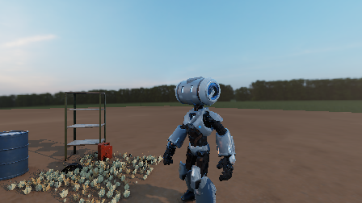

# 在自己的场景里接入 AI 角色

工作间里有一部损坏的电梯和一名维修员。电梯当前的耐久是 40，维修员能在两米内操作它。玩家说“修好身边的电梯”后，模型从当前可做的工作中选出 `repair`。引擎逐帧检查电梯还在不在、维修员能不能够到它。工作满一秒，电梯的耐久变成 70，维修员才发出“设备修好了”的回执。你可以用这两个实体试完一整次调用，无需准备地图、角色模型或动画。

## 角色和设备

第一次读源码，可以先跟一次玩家发话。游戏脚本调用 `Npc.Submit`，场景中的 `NpcSystem::Ask` 把当前能做的动作和这个角色记得的事情放进请求。网络请求返回时，`Accept` 认回提问时的那条候选，让行为树选出接下来要执行的动作。之后每帧由 `Execute` 推进。想弄清瓦特为什么选了箱子，先看提问时的候选和连线。想弄清伸手以后有没有拿到，才需要看交互和背包。[玩家发话到动作执行](../Redflag/src/Redflag/AI/NpcSystem.cpp) · [收集候选](../Redflag/src/Redflag/AI/NpcQuery.cpp) · [世界中的拿取与交付](../Redflag/src/Redflag/Gameplay/WorldActions.cpp)

把 `NpcComponent` 加在维修员身上，让 `Definition` 指向角色 YAML。示例只给维修员一种工作。配置中的 `Target: interaction` 表示寻找场景里提供交互的设备，`Key: repair` 要与设备的 `InteractionComponent.Action` 对应。行为树把模型选中的 `repair` 连到执行维修的动作。角色定义里的 `Tree` 相对于这份 YAML 查找。为电梯添加 `HealthComponent` 和 `InteractionComponent` 后，游戏就能知道要修多久、能修多少。[维修员的定义](../examples/npc-runtime/technician.npc.yaml) · [两节点的行为树](../examples/npc-runtime/technician.tree.yaml) · [示例中创建实体的代码](../tests/NpcRuntimeSmoke.h)

引擎默认向本机 8716 端口的决策服务提交请求。已有兼容聊天接口时，在仓库根目录用下面的命令启动。把地址和模型名换成自己的服务实际提供的值。这个例子只读取文字。启动器的 `-RequireAll` 让命令在所需服务启动失败时返回错误，以便宿主显示故障。模型已按项目脚本的默认目录安装时，也可以用 `.\scripts\Start-NpcServices.ps1 -SkipSpeech -RequireAll` 启动。[服务参数和本机默认模型路径](../scripts/Start-NpcServices.ps1)

```powershell
.\scripts\Start-NpcServices.ps1 -ModelEndpoint http://127.0.0.1:8000/v1/chat/completions -ModelName your-model -SkipSpeech -RequireAll
Invoke-RestMethod http://127.0.0.1:8716/v1/health
```

## 从游戏脚本发出指令

将脚本编入游戏脚本程序集 `Sandbox.dll`，在维修员的脚本组件里选择 `Workshop.RepairOrder`。进入 Play 后，`OnCreate` 会发出一次指令。这里的 `Id` 是维修员在本局中的实体编号。返回 `true` 表示引擎找到了可选的工作并开始询问模型；进度和结果要在后续帧读取。模型服务断线时，读到的记录会说明请求失败，电梯保持原来的耐久。[完整可编译脚本及 OnDestroy](../examples/npc-runtime/RepairOrder.cs)

```csharp
// examples/npc-runtime/RepairOrder.cs，Workshop.RepairOrder.OnCreate
if (!Npc.Submit(Id, "修好身边的电梯。"))
    Console.WriteLine("维修员目前没有可以处理的设备。");
```

每个读者为这个角色保存一个初值为零的 `ulong cursor`。每次成功读取，编号会向前移。界面和玩法脚本各保留自己的编号，都可以读到同一条结果。游戏只留下每个角色最近的 128 条，需保存整局日志时要持续读取并自行落盘。回执里的 `Time` 是这局运行以来的实际秒数，`Target` 是设备的实体编号，零表示这条记录没有目标。`Kind` 表示发生了什么。读到“选择”时维修才要开始；读到“完成”、`Text == "repair"`、`Target == 82` 时，才能给示例中的这部电梯刷新任务标记。`Speech` 可供字幕或语音播放使用。[C# 接口](../Redflag-ScriptCore/Source/AI/Npc.cs) · [游戏完成维修的代码](../Redflag/src/Redflag/Gameplay/WorldActions.cpp)

```csharp
// examples/npc-runtime/RepairOrder.cs，Workshop.RepairOrder.OnUpdate
NpcEvent entry;
while (Npc.TryReadEvent(Id, ref cursor, out entry))
    Console.WriteLine("{0} | {1} | {2} | {3}", entry.Kind, entry.Text, entry.Target, entry.Speech);
```

玩家改主意时，`Npc.Cancel(Id)` 会取消尚未得到的模型回答，或中断正在进行的动作。返回 `true` 表示确实有工作被取消。上述例子中，满一秒前取消，电梯仍为 40；已经修完再取消，耐久保留为 70。需要改派另一件工作时，直接调用 `Submit` 即可，它会先停止前一项。角色以后仍会响应新指令以及场景里新发生的事情。[请求、取消与动作完成](../Redflag/src/Redflag/AI/NpcSystem.cpp)

## 由 C++ 宿主推进一局游戏

Forge 的 Play 创建一份可独立修改的场景，再调用 `OnRuntimeStart()`。自己写宿主时，先初始化引擎日志和 `ScriptEngine`，准备场景，再沿用这三个调用。运行目录里需有 `mono/lib`、`Resources/Scripts/Redflag-ScriptCore.dll` 和游戏的 `Sandbox.dll`。默认端口为 8716；如果启动器使用了别的 `-DecisionPort`，请把同一个端口传给 `OnRuntimeStart(port)`。[Scene 的生命周期](../Redflag/src/Redflag/Scene/Scene.cpp) · [Mono 加载程序集](../Redflag/src/Redflag/Scripting/ScriptEngine.cpp)

```cpp
// tests/NpcRuntimeSmoke.h，CheckNpcRuntime 使用的宿主入口；以下省去实体创建和游戏循环。
room.OnRuntimeStart(port);
NpcSystem* actors = room.GetNpcs();  // 生命周期跟随这份运行场景。
room.UpdateGame(1.0f / 60.0f);      // 示例按 60 Hz 推进一帧。实际宿主传这一帧经过的秒数。
room.OnRuntimeStop();
```

C++ 的 `actors->Submit(id, text)` 也能发令，`NextEvent(id, cursor)` 每次返回一条，读完本帧已有记录后返回空指针。它借用场景里的记录，要跨帧保存时复制内容。场景线程每次 `UpdateGame` 都会运行脚本、取回模型的回答，然后推进动作、动画和物理；脚本在下一帧能读到刚发生的结果。网络线程只传回选择，物品和设备由场景线程修改。停止 Play 会释放这局的角色、回执和后台请求。另开一局时重新取得 `GetNpcs()`，读取编号也从零开始。[C++ 接口](../Redflag/src/Redflag/AI/NpcSystem.h) · [后台请求的销毁](../Redflag/src/Redflag/AI/DecisionClient.cpp)

## 运行工作间示例

维修员也可以只读仪表。示例在项目程序集里定义了 `Workshop.ReadGauge`，继承 `NpcAction`。选中行为树的动作节点，在「项目脚本」中选它，模型下次选中这条边时就会调用脚本。每一帧，`Tick(actor, target, seconds)` 收到维修员、设备和这一帧经过的秒数。脚本等半秒模拟读表，读取设备耐久，然后返回 `Completed`。玩家中途改令时，引擎调用 `Cancel`，下一次读表从零开始。运行示例时先把电梯从 40 修到 70，再把同一个选择接到读表动作，可以同时在日志和实际耐久上看到差异。[读表示例](../examples/npc-runtime/ReadGauge.cs) · [场景中的验证](../tests/NpcRuntimeSmoke.h)

在 Windows 上先构建 Debug x64 的 Redflag 引擎和 Redflag-ScriptCore，再从仓库根目录执行 `python tests/check_npc_runtime.py`。测试在临时目录编译上面的 C# 脚本，加载真实 Mono、场景和 HTTP 网关。网关使用自动分配的本机端口，测试中的模型只返回引擎提供的维修选项，因此无需下载模型权重。终端会打印角色的选择、取消和完成记录，也会检查电梯的耐久、两位读者的回执和停止后的场景状态。需要测真实模型的选择能力时，使用独立的模型测试。[工作间运行脚本](../tests/check_npc_runtime.py) · [模型选择测试](../tests/check_decision_service.py)

本机已有决策服务时，在相同目录加上 `--port 8716`，工作间会把同一条维修指令交给这个真实模型。本机的 Qwen3-VL-2B-Instruct 也跑过这个示例。中途取消后设备保持 40，重新发令后升到 70，C# 收到了设备 82 的一次维修完成回执。[实测记录](../output/validation/runtime-ai/scene-sdk.json)

## 巡检员的观察和转述

玩家拿来一张阀门照片，说阀门是蓝色的。游戏脚本用 `NpcNotes.Report` 把这句话、照片编号和阀门的实体编号放在巡检员名下。下次提问时，引擎从角色所在位置向实体检查距离与遮挡。本例中，阀门在四米外，角色能看六米。场景中给它起的名字是“红色阀门”。因此模型同时收到“现场看见红色阀门”和“玩家说阀门是蓝色的”，两条都指向实体 82。这次观察读的是场景作者写的名字。需要模型辨认照片里的实际颜色时，游戏脚本还要在这次模型请求中附上图片。[可运行的 C# 脚本](../examples/npc-memory/SurveyNotes.cs) · [候选与观察的收集](../Redflag/src/Redflag/AI/NpcSystem.cpp)

```csharp
// examples/npc-memory/SurveyNotes.cs，SurveyNotes.OnCreate
NpcNotes.Report(Id, 82, "玩家说阀门是蓝色的", "round-a.png");
NpcNotes.Report(Id, 0, "玩家拍下了控制面板", "panel-b.png"); // 这张照片尚未对应到场景物体。
```

把一块隔板放在巡检员和阀门之间，再问同一句话，PhysX 的射线先碰到隔板。模型收到的阀门记录会变成“上次看见”，时间仍是上次见到它时距本局开始经过的秒数。移除实体之后也保留这段过去的见闻。模型即使要求去拿东西，实际动作仍须通过当前场景的检查。脚本可用 `TryRead` 逐条读出本角色的来源、物体编号、时间、文字和图片编号。连续读一份记录时，可在同一帧从索引 0 读到返回 `false`。[独立 C++ 宿主](../examples/npc-memory/MemoryHost.cpp) · [C# 接口](../Redflag-ScriptCore/Source/AI/NpcNotes.cs)

作者在角色 YAML 的 `Memory` 中指定能留下哪些内容。`Limit` 是这个角色最多保留的观察和转述条数，满了先换掉最早的一条。`LastSeen` 可以关闭过去的现场记录，`Reports` 可以关闭玩家转述。示例把路线 `route` 设为 `session`，把语言 `language` 设为 `saved`。脚本通过 `NpcNotes.SetPreference` 写入这两个名称，其他名称会返回 `false`。结束一局时，`SavePreferences` 返回可写进玩家存档的 YAML。重开游戏后，由新角色调用 `LoadPreferences` 读回语言。本局路线、玩家转述和过去的现场记录都随原场景结束。[角色设置](../examples/npc-memory/surveyor.npc.yaml) · [记录与存档实现](../Redflag/src/Redflag/AI/NpcMemory.cpp)

从仓库根目录执行 `python tests/check_npc_memory.py`，会启动独立宿主，编译并运行示例里的 C#，然后从本机 HTTP 网关记下阀门可见、遮住、移除和重新开局时的四份输入。测试用一个按记录来源选择动作的模型替身，使场景变化和动作选择可以重复核对。加上 `--model-port 8716` 会把同样的四份输入也交给该端口的模型，并在 JSON 中列出它实际选的动作。[验证程序](../tests/check_npc_memory.py) · [观察和模型的实测输入](../output/validation/runtime-ai/memory.json)

第一版把“确认阀门颜色”的目标填成了队友。隔板升起以后队友还在旁边，因此模型仍能选“确认”。在四轮输入中，本地 Qwen3-VL-2B 都选了它。把动作目标改成可见的阀门备件后，角色面对阀门时可以选“确认”或“复查”，隔板挡住阀门时只能选“复查”。实际模型在四轮里依次确认、复查、复查、复查，行为树也确实执行了相应动作。过去见过的东西可以帮助角色交谈；要执行现在才能做的事，还要把那个实体填成动作的目标。[初版选择](../output/validation/runtime-ai/memory-unrestricted.json) · [修正后的真实模型与宿主](../output/validation/runtime-ai/memory-model.json)
## 队友相机

在 Vulkan 游戏里按 T 打开「队友通讯」，选中角色并展开「从队友眼中观察」。想看它正对着什么，可以选「描述所见」，输入“描述面前的地表和设施”，点击「拍照并提问」。相机从这个角色的眼睛向前拍，游戏的第三人称镜头和 HUD 都不会出现在照片里。「保存这张原图」能把实际发给模型的 PNG 存到游戏工作目录的 `captures/npc`。下面是维修站开局时瓦特拍到的画面。[相机的绘制与读回](../RedflagForge/src/NpcCamera.cpp)



Qwen3-VL-2B 在这张图上认出了裸露的棕色地面、金属架和机器人，也把架子前面的浅色植物描述成了“类似蛋的物体”。自由描述会以「照片」为来源留在瓦特自己的记录中。通过 `NpcNotes.TryRead` 可以查到拍摄时经过的秒数、照片编号和模型原话。只有游戏查回具体实体时，记录里才会有对应的实体编号。照片回答不会修改物品、地形或灯。[角色记录接口](../Redflag-ScriptCore/Source/AI/NpcNotes.cs) · [原始答复](../output/validation/npc-live-camera/observations.tsv)

「找画面中的物体」还会读取拍照时每个像素上的实体编号。比如墙前有一个红色立方体，立方体背后的墙也占着同一片屏幕区域。若只告诉模型两个外框的坐标，它曾经把墙选作答案。现在引擎会把同一物体的可见像素裁成一张特写，留下物体原有的颜色，把旁边物体的像素涂灰。模型选中一张特写后，还要单独看这张图，确认里面确实有想找的物体。画面复杂时每次最多发送八张特写，按画面中实际占据的像素数选取。照片太小、遮挡严重或物体未进入候选时都可能漏认。[特写与实体对应](../RedflagForge/src/NpcCamera.cpp) · [模型确认与物理查询](../Redflag/src/Redflag/AI/PhotoQuestion.cpp)

拍到红色物体以后，队友可能在模型回答前搬走它。瓦特仍然可以说「刚才照片里有一块红色的东西」。这句话的依据是那张照片，拿取则要等瓦特伸手时，由场景检查物体还在不在、手够不够远、中间有没有挡板。模型把草丛看错也会留下原话，创作者可以回到照片核对。[相机测试与原图](../output/validation/npc-live-camera/README.md)

队友也可以只提供大致地点。例如玩家说「前面像有一箱补给，也可能只是个空架子」。把玩家指的地方和原话交给角色，游戏可以完全没有那个箱子的实体编号。玩家请瓦特转告别人时，它能原地复述这条线索。要求过去看看时，它走向标记，从新位置拍照并回答。角色真的拿到东西时，背包数量才会改变。

```csharp
// Redflag-ScriptCore/Source/AI/NpcNotes.cs。在游戏脚本里，marker 是玩家放下的标记。
Vector3 place = marker.GetComponent<TransformComponent>().Translation;
NpcNotes.ReportPlace(companion.Id, ref place, "前面像有一箱补给，也可能只是个空架子。");
Npc.Submit(companion.Id, "去我标记的地方重新看看。");
```

照片能给出方向，单张照片里的箱子究竟有多远往往看不出来。瓦特的动作表里可以选择「到附近查看」。角色设置的 `SearchStep` 决定先沿这个方向走多少米，维修站使用 3 米。走到距标记 1 米时就停下观察，这个距离由 `SearchRadius` 决定。玩家直接给了标记时，就去标记附近。遇到走不过的障碍，瓦特会停在可到达的位置再看。玩家改令后，先前的看图回复不能重新启动旧动作。[角色设置](../RedflagForge/assets/ai/watt.npc.yaml) · [角色脚本接口](../Redflag-ScriptCore/Source/AI/NpcNotes.cs)

角色定义中的 `ObserveWorld` 控制它能否收到作者配置的地貌等场景信息。`ObservePictures` 控制相机拍照和照片记录，可在「角色创作 → 角色 → 允许用角色相机拍照」修改。公开的 C++ 接口 `PhotoQuestion::Start` 接收宿主给的 PNG 和候选物体；`Update` 在游戏线程收取答复。Forge 自带的 `NpcCamera::Take` 会填写观察者、拍摄时间、眼睛位置、朝向和实体编号。默认眼睛位于角色原点上方 1.55 米、前方 0.28 米，垂直视角 65 度。体型不同的角色可在各自的 `.npc.yaml` 中配置，如 `Eyes: {Height: 0.65, Forward: 0.12, VerticalFov: 60}`。[照片数据](../Redflag/src/Redflag/AI/NpcPhoto.h) · [C++ 提问入口](../Redflag/src/Redflag/AI/PhotoQuestion.h)
