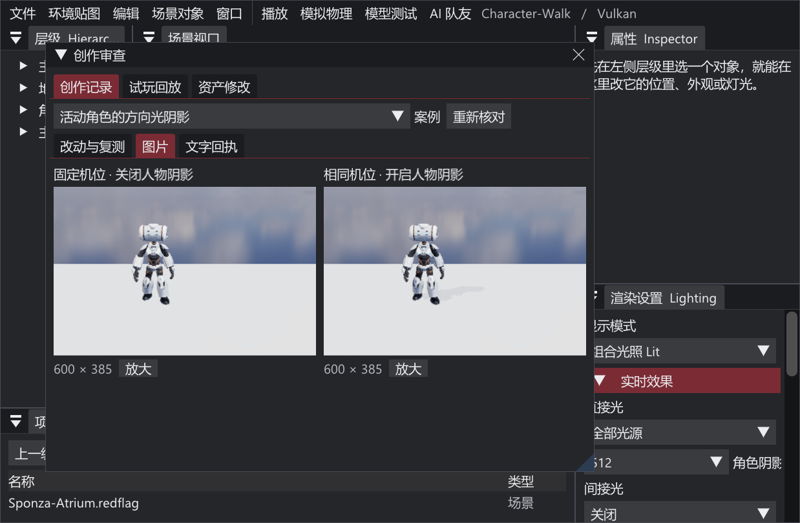
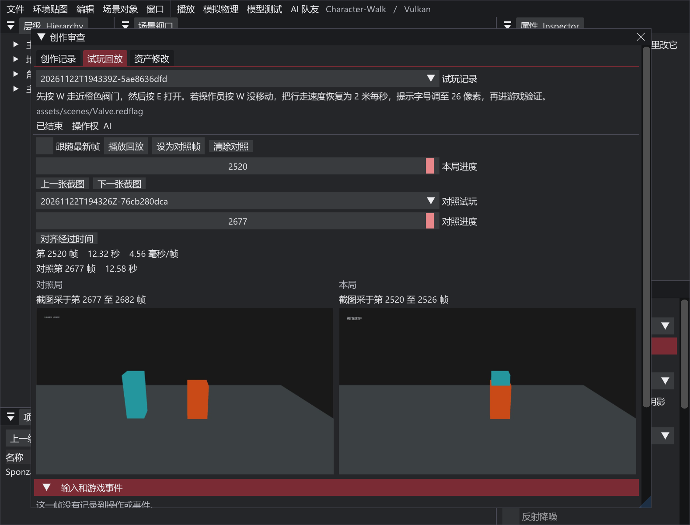
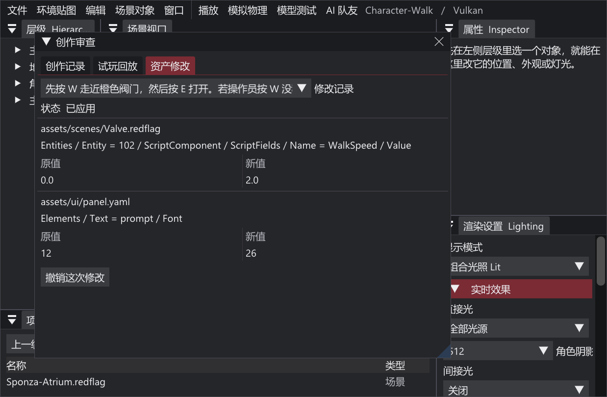
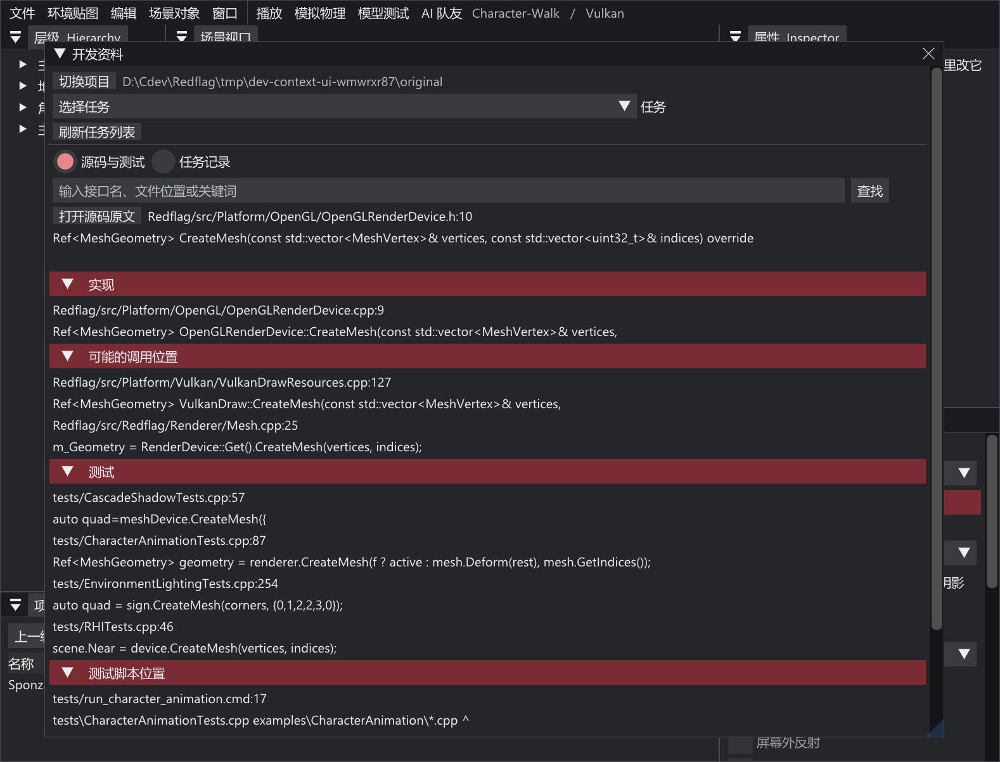
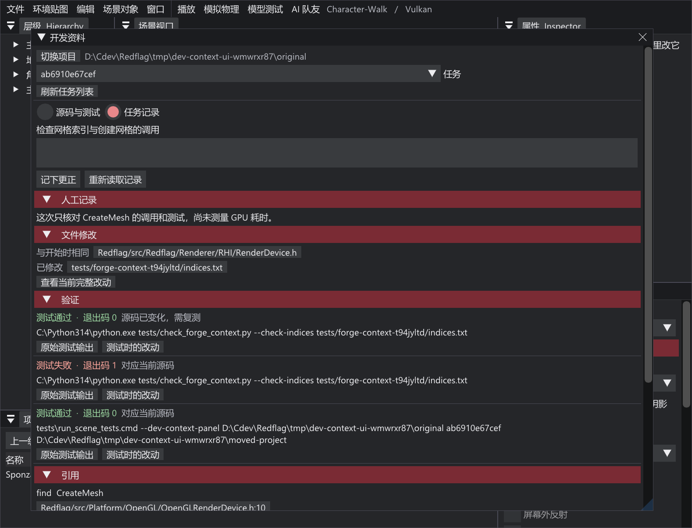

# 在 Forge 里审查一次改动

打开 Vulkan 版 Forge，选择 **窗口 → 创作审查**。下拉框里的每个案例都对应一次可以复查的改动。“改动与复测”写明这次想做什么、各系统改在哪里，以及怎样重复这次操作。“图片”可以点击放大，“文字回执”显示测试工具实际写下的内容，也可复制到自己的排错笔记。

例如，打开“主角的落地恢复时间”，看图片中蓝色和橙色的角色骨架，再到回执页选“修改后的 C# 事件”。角色 1992 在 0.30 秒收到了恢复结束通知。角色 1993 刚开始就改播待机，结束通知的最后一个值为 True，表示期间发生了打断。这样可以分别检查改动在编辑器里长什么样，以及游戏脚本读到了什么。

“活动角色的方向光阴影”使用 RenderDoc 回放导出的两张图。两张图的相机和角色位置相同，分别关闭和开启人物阴影。可以先看脚下的地面，再打开数值回执查看有多少像素受到遮挡。回执里还保留了程序版本和帧号，便于回到同一次采集。



这是正式 Vulkan 编辑器打开阴影记录的窗口截图。角色脚边向右伸出的灰影只出现在右图。点「放大」可看原始画幅。动作案例的左图则能看见保存时与草稿时的骨架姿势。[动作记录的窗口截图](../output/validation/creation-review/animation-events.png)

## 试玩和回放

检查脚步或出拳时，调用 MCP 的 `begin_playtest`，给 `pose_nodes` 填入模型里要看的骨骼名，例如维修员的 `foot.L`、`toe.L` 和 `hand.L`。游戏每帧把这些关节的世界坐标连同剪辑名、播放时间写进角色记录。脚尖相对地面的变化能用来查滑步，拳头相对肩膀的变化能用来查手臂有没有伸出。普通游玩省略这个参数即可。[维修站实拍与逐帧数据](../output/validation/packaged-watt/animation/README.md)

选择「试玩回放」，下拉框里是当前项目录过的各局游戏。每局显示场景、试玩目的、运行状态和谁在操作。游戏由 AI 操作时，可点「接管操作」自己玩，再点「交给 AI」。如果试玩在另一个进程运行，编辑器先显示等待消息，收到那一局游戏的回执后才显示新的操作权。

想检查玩家卡在哪里，可以取消「跟随最新帧」，拖动「本局进度」，或用「上一张截图」「下一张截图」寻找画面。角色位置和按键逐帧记录，窗口截图的间隔更长。截图上方标着采集的帧号范围。查一个动作时，请同时看选中帧的时间、输入和事件。展开「角色与交互物体」可读位置、生命值、当前动作及物品。录音会注明请求、设备首次读到人声、开始前取消或中途停止。「回听已播放部分」只播到那一帧设备实际读过的位置，「试听合成整句」则打开完整 WAV。例如维修站中角色 1102 的一句话已合成 2.16 秒，设备在第 12 帧停在第 14700 个采样。以每秒 16000 个采样计算，当时只播了 0.919 秒。[录音与设备回执](../output/validation/playtest-audio/station/media.jsonl)

「设为对照帧」固定当前的画面，再拖动进度条就能看同一局的前后变化。若改过关卡再试一遍，在「对照试玩」选修改前的那局。左图显示对照局，右图显示本局。两条进度可以各自拖动。「对齐经过时间」按游戏已运行的秒数寻找对照帧，遇到两次操作时刻不同的情况，可以再手动选准。想留下具体意见，在「本帧批注」选整帧或场景物体，输入现象，点「保存到这一帧」。开始输入后，画面会停在正在评论的帧。之后用「跳到批注」找到它。



在这张图里，蓝绿色物体是操作员，橙色物体是阀门。左图采于修改前第 2677 至 2682 帧，按 W 后操作员仍留在原地。右图采于修改后第 2520 至 2526 帧，操作员已走到阀门前，左上方提示阀门已打开。两局各自的帧号和经过时间都能在图上找到。原始会话包含按键回执、每帧的位置和从游戏窗口取得的图片。[两局原始记录](../output/validation/harness-valve)

## 检查资产修改

切到「资产修改」。一份提案可以同时包含玩家的移动速度与提示字号，每行都会列出资产文件、字段位置、原值和新值。点「应用到项目文件」后重新打开相应资产即可检查效果。「撤销这次修改」逐项恢复原值。面板和命令行共用保存逻辑。比如作者在等待审查期间另改了门牌文字，应用与撤销都会保留这段文字。如果双方都改了字号，面板会展示冲突，原文件保留作者当前的值。[实际控件的验收回执](../output/validation/creation-review/controls.json)



维修间这份记录从两个文件各取了一项。操作员的速度由 0 恢复为每秒 2 米，界面字号由 12 调为 26 像素。点「撤销这次修改」后能回到造成问题的数值，再次应用即可重新试玩。

## 把自己的工具输出交给 Forge

在外部游戏项目中，把图片、测试日志或 JSON 放进 `output/validation/案例名/`。Redflag 仓库自带的 Forge 项目沿用仓库根目录的 `output/validation/`。先跑自己的测试，留下原始文件，再写一份短说明。下面假设该目录里已有 `before.png`、`after.png` 和 `result.json`，其中的名称均可更换。

```json
{
  "title": "维修门的开启范围",
  "intent": "核对把手旁的提示和物理交互是否同时生效。",
  "systems": [
    {"name": "界面", "change": "靠近把手时出现交互提示。"},
    {"name": "场景交互", "change": "按 E 时重新检查角色和门的距离。"}
  ],
  "steps": [
    {"action": "分别在把手旁和栏杆外按 E。", "expect": "在把手旁门会打开，隔着栏杆时门保持关闭。"}
  ],
  "evidence": [
    {"label": "靠近把手", "file": "before.png"},
    {"label": "成功开门", "file": "after.png"},
    {"label": "两次按键的反馈", "file": "result.json"}
  ]
}
```

这份说明是格式示例。将它另存为 `door.json` 后，在引擎仓库根目录使用安装了 Pillow 的 Python 运行下列命令。外部项目可在子命令前加 `--project D:/Games/MyGame`，也可以设置 `REDFLAG_PROJECT`。

```powershell
python scripts/redflag_mcp/creation_reviews.py publish door door.json
python scripts/redflag_mcp/creation_reviews.py list
python scripts/redflag_mcp/creation_reviews.py check door
python scripts/redflag_mcp/creation_reviews.py open door --page images
```

发布时，工具会打开图片、读取文字，并为每份证据计算 SHA-256 文件指纹。所有证据都能读取后才保存 `creation.review.json`。打开 Forge 并点“重新核对”，新案例就会出现。测试重跑后，即使图片仍叫原来的名字，只要内容改变，面板也会指出哪个文件需要重新核对。确认新图确实代表本次改动后，再发布这份说明。

使用项目的 MCP 时，工具可以调用 `publish_creation_review`、`list_creation_reviews` 和 `get_creation_review`。例如可以告诉 Agent：“运行两次关卡，把原始截图和选择回执放在同一个验证目录，写清机位与复测条件，再发布成一份创作审查。”打开记录、查看步骤都是只读操作；复测命令由开发者或获得授权的工具执行。


复查一份试玩时，也可让工具直接指向某一帧。将下例的大写名称换成实际会话文件夹名、帧号和项目路径，从引擎仓库根目录运行。要只看本局时，省去最后两项即可。

```powershell
python scripts/redflag_mcp/creation_reviews.py --project D:/Games/MyGame open CURRENT --page playtest --frame 85 --baseline BEFORE --base-frame 79
```

## 源码、测试与开发记录

在 Vulkan 版 Forge 里打开「窗口 → 开发资料」，在 OpenGL 版里打开「View → 开发资料」。想查一个接口时，先在「源码与测试」输入名称，例如 `CreateMesh`。同名接口可能在设备接口、OpenGL 后端、Vulkan 后端各有一处。看清类名和文件后点一项，窗口会列出签名、可能的调用位置、测试及其运行入口。点具体的源码位置，可以读到那几行原文。如果声明在生成 API 手册之后又改过，窗口会告诉你索引需要更新。[源码窗口](../RedflagForge/src/UI/DevContextPanel.cpp) · [查询实现](../scripts/context_index.py)



复核一项开发任务时，从上方下拉框选择它。勾选「把这次查询记入选中的任务」后，接下来的搜索和点开的源码都会留下记录。切到「任务记录」，可以检查开始时提到的文件、实际运行的测试、已有意见和证据目录。比如同事写下“网格创建更快了”，但记录里仅有功能测试，你可以在输入框补充“这次只核对调用和测试，尚未测量 GPU 耗时”，再点「记下更正」。原来的测试仍可查到，下一位使用命令行或 MCP 的开发者也会读到这条意见。[共用的任务记录](../scripts/context_review.py) · [窗口输入与 CLI 回读验证](../tests/check_forge_context.py)



这里用一份很小的网格数据演示两种容易混淆的状态。第一次测试读到 300 个顶点索引，每三个组成一个三角形，正好画 100 个。随后把索引数改成了 331，再次运行时，最后一个三角形只有一个索引。第一条记录仍显示当时的「测试通过」，右边的「源码已变化，需复测」提醒你它验证的是旧文件。第二条写着「测试失败」，右边的「对应当前源码」说明这次失败仍可复现。

点第二条的「原始测试输出」，翻到下一页可以看到最后一个三角形和失败原因。「测试时的改动」打开那次运行前保存的完整差异，其中以 `+` 开头的行是新增的索引。如果在测试之后又编辑了源文件，点「查看当前完整改动」可以读到从任务开始到现在的变化。阅读窗口可以复制完整路径，也可以在资源管理器里直接定位文件。[原始测试输出](../output/validation/forge-context/indices-output.txt) · [测试时保存的差异](../output/validation/forge-context/indices.diff) · [Forge 中的差异](../output/validation/forge-context/diff.png)

查具体一行时，在「源码与测试」输入仓库路径和行号，例如 `tests/SceneRenderTests.cpp:45`，点击「打开源码原文」就能向前或向后翻页。在「任务记录」点击引用下的「当时的查询记录」，能读到当时返回的内容。点击「打开证据目录」可查看该任务的全部测试、引用和更正。把项目搬到另一个目录后，在面板上点「切换项目」，输入含有 `captures` 的项目目录并重新选择任务，日志和测试时保存的差异就从新位置读取。源码位置按引擎检出目录解析。
