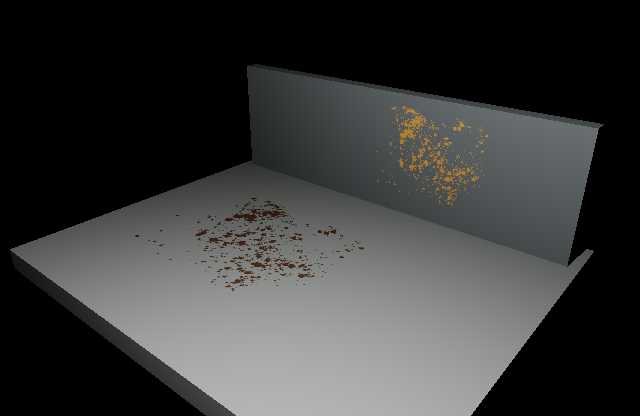

# 地面泥渍与墙面油漆

在 Vulkan 版 Forge 打开 `assets/scenes/Decal-Paint.redflag`，把场景视图设为 **Lit**。靠近镜头的泥渍和墙上的黄色油漆用了同一张带透明背景的图片。地面选了深棕色，粗糙度设为 0.16，与周围地面的 0.76 相比，光照在污渍上会更集中。墙面的粗糙度是 0.62，接近原墙面。这两个数是此示例的美术设置。[示例场景](../RedflagForge/assets/scenes/Decal-Paint.redflag)

## 放置贴花

在层级里选中「地面泥渍」，属性里能看到**贴花**。要在自己的场景做一个，从空实体的「添加组件」里选「贴花」，点「选择贴花图片」或把项目中的 PNG 拖到这个按钮上。PNG 的透明区域会露出原来的表面。先把实体中心放到地面，把宽和高调到希望的尺寸，再调厚度。示例的厚度是 0.16 米，地板与盒子中心相交。厚度越大，投影也可能落到上下相邻的表面。

贴花默认向下投影。选中「墙面油漆」，可以看到它绕 X 轴旋转了 90°，图片的正面朝向镜头这一侧的墙。最大倾角决定哪些斜面还能接到图案。当表面正对投影时，颜色最完整，逐渐转到限制角度时图案淡出。重叠的两张贴花按「叠放顺序」绘制，数值大的覆盖在上面。删除组件或将透明度调为零，下一帧恢复原来的墙面。[贴花设置](../Redflag/src/Redflag/Scene/DecalComponent.h)

相同的组件可以使用鞋印、划痕或撞击印记的透明 PNG。把粗糙度调低可以表现潮湿，标记露出的裸金属时可提高金属度。当前实现影响 Vulkan 光照视图中相机看到的不透明表面和通过透明裁剪的像素。透明玻璃单独绘制，静态探针也不会烘焙这些图案。[Godot 手册中的投影方向与材质参数](https://docs.godotengine.org/en/stable/tutorials/3d/using_decals.html)

## 图案怎样留在墙上

渲染器画完几何后，已经知道每个像素对应的世界位置。把这个位置换算到贴花盒子的坐标里，盒子中心是 0，三个方向的表面分别在 −0.5 和 +0.5。位于盒外的像素保留原材质。盒内用局部 X 和 Z 读取图片，图片中心对应 (0.5, 0.5)。当墙面与盒子平行、读到一处半透明油漆时，渲染器将墙面和油漆各取一半。颜色在线性空间中混合，再交给光照计算。[计算着色器 Decal.comp 中的 main](../Redflag/src/Platform/Vulkan/Shaders/Decal.comp)

沿地面看一个具体像素。坐标从渲染图的左上角起算，横向 289、纵向 267 处，原来的灰色底色是 (0.36, 0.39, 0.40)。RenderDoc 回放中，地面贴花算完后，该点变成 (0.151, 0.083, 0.047)，粗糙度从 0.76 变为 0.19。屏幕上显示为深棕色还经过点光源照明和 ACES 色调映射。点击旁边的天空时，这一步找不到地面或墙面，背景保持原色。[同机位原图及逐像素回放](../output/validation/decals/README.md)

场景只保存图片路径和投影设置，复制到游戏中后可以独立修改。每个视口的 `DecalRenderer::Update` 读取当前场景，两个投影器共用一次上传的图片。投影盒或图片改变时，场景视图重新绘制。在 `DecalRenderer::Draw` 中，每个盒子先换算成屏幕上可能受影响的矩形，然后才处理该区域里的像素。最后一个使用者移除图片时，视口释放它的显卡资源。[渲染代码](../Redflag/src/Redflag/Renderer/DecalRenderer.cpp) · [LightingPreview::Render](../RedflagForge/src/LightingPreview.cpp)

示例图案出自 johndn 的 Splatter pack，沿用 Godot 示例中的原始 PNG，许可为 CC BY 3.0。截图来自 Redflag 的 Vulkan 渲染。[图片来源与许可](../RedflagForge/assets/textures/decals/LICENSE.md)
