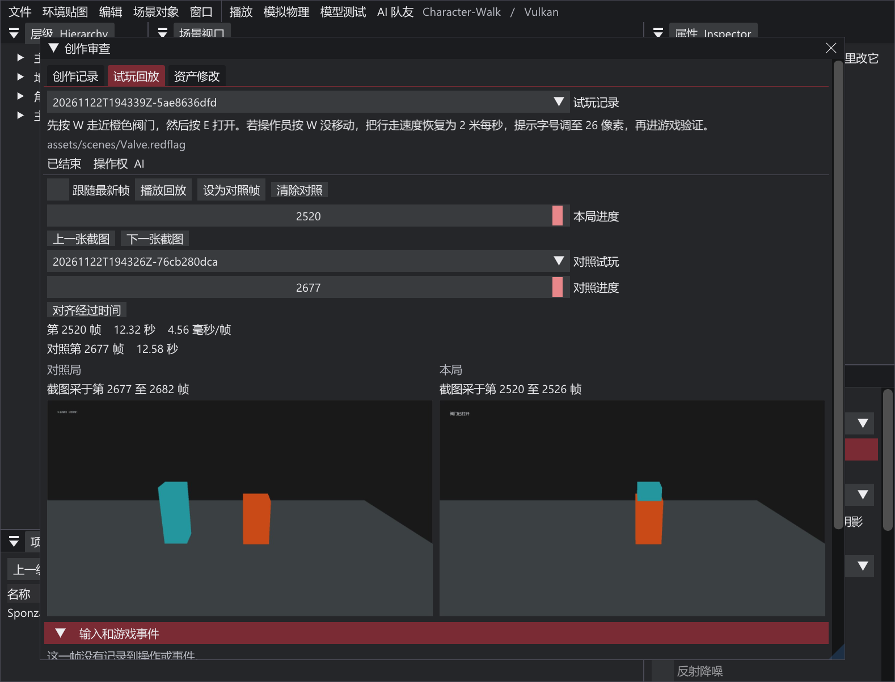
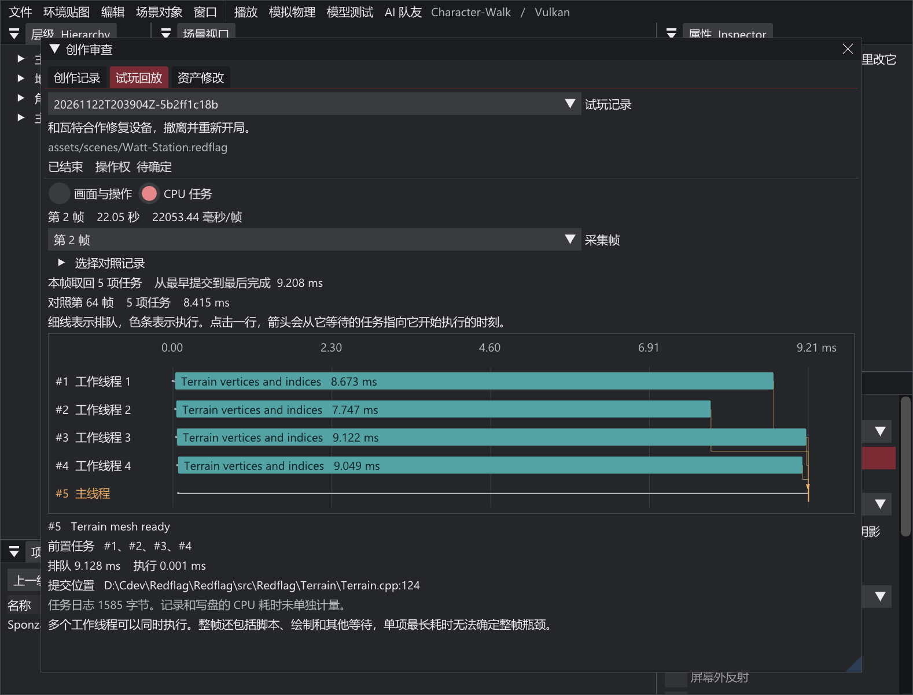

# 在 Forge 里复查一局游戏

维修间有一个操作员和一个阀门。开发者希望玩家走到阀门旁，按 E 打开它。我们在项目副本中把行走速度设为零，并把操作提示的字号缩小。模型面对的是真实的 Vulkan 游戏窗口。它能看到画面，读取操作员所在的位置，并从项目允许的操作中决定下一步。[可编译的维修间示例](../examples/valve-room/ValveRoom.cs)

第一局里，游戏收到了 W，操作员的 X 坐标始终是零。模型根据记录与作者给定的目标，把场景里的速度改为每秒 2 米，把另一份 HUD 布局中的字号从 12 改为 26。第二局角色走了 1.25 米，进入操作范围，按 E 后脚本发出一次开阀事件。它到达后还多按了两次前进键。这两次操作在报告里单独列出，创作者可以判断这段停顿是否合意。这局只有界面提示，声音栏为零。[两局原始记录](../output/validation/harness-valve/iterations.json) · [实际修改的两个字段](../output/validation/harness-valve/asset-change.json)



在 Forge 的「窗口 → 创作审查」打开「试玩」，先选一局，再选择要比较的旧局。两边可以按经过的秒数对齐，也可以各自停在一帧。图片下方标出采集画面前后的帧号。查看人物位置或按键时，以选中的游戏帧为准。在实体旁写下意见，这条意见会保留实体编号和帧号。游戏仍在运行时，可以接管角色。游戏在交接时松开模型按住的键，旧模型即使稍后收到回答，也无法继续控制角色。[界面操作](Creation-Review.md)

瓦特递药时有实际声音。一次实测中，设备收到了 34,560 个样本，玩家收起通讯窗口时实际播放了 14,700 个。采样率为每秒 16,000 个，玩家听到约 0.919 秒。这样可以分清“合成完整句子”和“玩家已经听到哪里”。[原始录音与设备读数](../output/validation/playtest-audio/station/media.jsonl)

## 地形任务的时间线

在「窗口 → 创作审查 → 试玩回放」选中一局，点「CPU 任务」，再从「采集帧」选择有任务的帧。维修站的第 2 帧取回了五条记录。横轴零点是最早一次提交任务的时刻。四个青色条分别对应四个工作线程，它们同时生成地形的顶点和索引。点最后一行，箭头会指向主线程开始接收网格的时刻。下面列出的四个任务编号来自这次提交时登记的依赖。点任何一条记录都能读到对应的源码文件和行号。[调度器的提交和计时](../Redflag/src/Redflag/Core/JobSystem.cpp) · [地形提交任务的地方](../Redflag/src/Redflag/Terrain/Terrain.cpp)



第 2 帧里，主线程那项任务在队列中等了 9.128 毫秒，实际只执行了 0.001 毫秒。从首个任务提交算到最后一项结束共 9.208 毫秒。这里记录到的整帧间隔却有 22.053 秒，单靠这五行数据解释不了首帧的等待。选择同一局第 64 帧作对照，可以看到重新开局时这批任务历时 8.415 毫秒。两次各只有一个样本，还不足以判断哪一种实现更快。[两帧的真实日志](../output/validation/job-timeline/replay/jobs.jsonl) · [逐项耗时](../output/validation/job-timeline/check.json)

只有游戏取回了已完成的任务，该帧才会出现在「采集帧」列表。因此画面上的帧号表示取回记录的时刻，任务可能在更早的帧已提交。第 2 帧的五项记录共 1,585 字节，写日志本身占多少 CPU 时间，这份旧回放没有单独测量。在仓库根目录运行 `python tests/capture_job_timeline.py` 可以用保留的原始行重开 Forge 并重拍这张图。[复测程序](../tests/capture_job_timeline.py)

## 接入自己的游戏

将项目放在包含 `assets` 的目录，用 `REDFLAG_PROJECT` 指向它。在 MCP 中用 `get_capabilities` 看当前可用的工具和试玩配置。用 `scene_dependencies` 查看已保存场景的角色、组件和资产引用。它和打包工具读取同一套依赖，能从 HUD 找到贴图，也能从 NPC 定义追到行为树。运行时创建的临时对象可通过游戏事件记录。

在 `assets/playtests` 放一份操作表。维修间用稳定实体编号指定要观察的角色，用按键和按住的时间描述动作。项目也可以声明希望看到的事件顺序、可调整的字段、单位和范围。通过 `iterate_playtest` 提供场景名、操作表和意图，模型每走一步都重新观察当前游戏。单独使用 `begin_playtest`、`explore_playtest`、`evaluate_playtest`、`revise_playtest` 可以逐步调试。想自己控制时，MCP 的 `control_playtest` 使用游戏刚返回的控制权编号，接管后由 Forge 交还。[完整操作表](../examples/valve-room/assets/playtests/valve.json)

玩法、动画、网络或物理系统都可以在真正发生变化时附上一条事件。维修间在角色进入距离范围时发出 `at_panel`，只有按下 E 并实际开阀后才发出 `valve_open`。C# 调用 `Playtest.Record(Id, "valve_open", "已打开阀门")`，C++ 可通过当前 `PlaytestSession` 的 `Event` 写入同一帧。动画开始和接触、发送和确认、资源请求和就绪，各自保留独立的事件。系统随后用 `transitions` 按实体核对两者间隔。游戏业务可以在没有开启录制时独立运行。[C# 接口](../Redflag-ScriptCore/Source/Playtest.cs) · [原生接口](../Redflag/src/Redflag/Debug/PlaytestSession.h)

编辑字段时，先登记意图、资产路径、稳定标识、原值与新值。在「资产修改」可以逐字段查看并应用或撤销。若作者同时调了同一字段，整次修改会停在冲突处。另一个字段的修改和原有注释可以保留下来。通用事务当前可修改场景、YAML、JSON 中已有的标量字段。新增表、行为树和图片沿用对应系统的创作工具。[字段修改实现](../scripts/redflag_mcp/asset_changes.py)

## 复现

在仓库根目录构建 Debug x64 的 Forge，启动项目的视觉模型服务，然后运行下面的命令。测试会建立一份独立的项目副本、编译其中的 C#，并输出可在 Forge 再打开的两局记录。源码网关会使用本机已经运行的模型。

```powershell
bin-int/redflag-mcp/Scripts/python.exe tests/check_playtest_iteration.py --provider http://127.0.0.1:18157/v1/chat/completions
```

会话记录的帧时间覆盖游戏主循环，包括当时的机器负载。若要找具体 GPU 绘制的代价，转到项目的 RenderDoc 记录。审查流程借鉴了 Unreal Gauntlet 按真实游戏会话收集结果的做法。[Epic Gauntlet](https://dev.epicgames.com/documentation/en-us/unreal-engine/gauntlet-automation-framework-in-unreal-engine)
