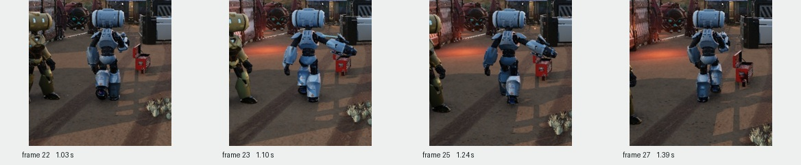

# 维修站的角色动作

玩家和瓦力共用维修员模型，巡检机使用另一套骨架。下面从游戏里能做的事情查到对应剪辑。「实机」表示已经在启动的游戏中取得画面、剪辑名或世界状态；旁边注明具体取得了哪一种。「模型」表示将正式 GLB 交给引擎播放器采样。比如能读出射击时右腕移动了多少，但单凭这个数字并不能判断脉冲有没有击中目标。

## 停步和移动中开火

维修员先向前走，松开 W，再按住 S 直到西侧护栏，最后按 W 离开。在旧版中，松键以后模型的腰一下子向后退了 23.66 厘米，实际负责碰撞的位置却仍在向前减速。两段动作的站立位置不同。重新导入待机及其他原地动作以后，这次后移为 0.59 厘米。从护栏离开时的位移从 0 增至 1.33 米，修的是球形碰撞查询处理轻微重叠的方式。可以在录像第 2 秒看停步，第 7 秒看护栏。[修改前录像](../output/validation/station-motion-stop/before.mp4) · [修改后录像](../output/validation/station-motion-stop/after.mp4) · [逐帧测量](../output/validation/station-motion-stop/result.json)

按住 W 并点鼠标左键，第 23 帧引擎发出脉冲。下面四张图出自同一次窗口录制。第 23 至 26 帧的基础动作一直是持炮走路，上身同时播放 `Cannon_Charge`。这段时间角色向前走了 0.66 米，左脚上下相差 18.1 厘米。第 27 帧手已经放回，脚步仍在继续。开火截取原片的前 0.22 秒，使用 0.08 秒抬臂、0.14 秒收臂，可以从 Forge 的「窗口 → 动画蒙太奇…」打开这个动作调整。从「窗口 → 动画过渡…」另行调整走路到待机的整身过渡，两项可以独立试手感。[开火动作](../RedflagForge/assets/ai/montages/fire.montage.yaml) · [实际脚本](../SandboxProject/Source/StationEquipment.cs)



## 玩家

| 操作 | 身体动作与恢复 | 已核实的结果 |
| --- | --- | --- |
| 行走、跑步、转身 | 徒手和持炮各有一组走跑动作。与位移相配的步态按角色实际走出的距离推进，松键后回到待机。 | 实机在转动相机后分别按前、后、左、右，并检查四个世界方向与持炮行走剪辑。模型核对了完整左右步幅。[移动与动作记录](../output/validation/watt-station/melee/movement.json) |
| 蹲下、蹲行 | 原地播放 `Station-Crouch`，移动改播 `Station-CrouchWalk`，松开 Ctrl 恢复站姿。 | 实机读出了蹲姿和蹲行。模型以 60 Hz 检查靴底，蹲行一个循环是 2 秒、1.453 米。[实机姿势](../output/validation/watt-station/melee/movement.json) · [靴底实测](../output/validation/station-actions/model.txt) |
| 出拳 | F 起手，左拳在 0.20 秒抵达最远处，收拳后恢复。倒地会打断出拳。 | 实机分别验证命中、距离不够、被墙挡住和倒地中断。完整剪辑长 0.867 秒，模型中左腕前移 0.551 米。[命中](../output/validation/watt-station/melee/hit.json) · [挥空](../output/validation/watt-station/melee/miss.json) · [隔墙](../output/validation/watt-station/melee/wall.json) · [中断](../output/validation/watt-station/melee/cancel.json) |
| 换装、瞄准 | 1 和 2 在臂炮与扫描器之间切换，两次都播放同一段装备动作的前 0.35 秒。静止持炮按右键显示单帧瞄准姿势 `AIM-Center`，松开回到待机。 | 实机记录到换装后两次回到待机、随后举炮瞄准。模型中瞄准时的右手与待机相差 0.578 米。这一帧由 `GameWorld.PlayClip` 显示；用需要正时长的 `Animator.Play("aim")` 无法启动时间轴。[装备实机记录](../output/validation/watt-station/interactions/equipment.json) |
| 发射臂炮、使用扫描器 | 左键发射从右手位置出发的脉冲，播放 `Cannon_Charge` 的前 0.22 秒。切到扫描器后，左键沿相机方向查找物体，身体保留当时姿势。 | 实机里扫描得到巡检机 1103，生命值不变；切回臂炮后命中同一目标，生命从 75 降到 50。模型在开火这 0.22 秒内右腕移动了 0.321 米。[装备实机记录](../output/validation/watt-station/interactions/equipment.json) |
| 起跳、滞空、落地 | 起跳与滞空分别播放 `jump_1_up`、`jump_3_midair-cycle`。落地剪辑的缓冲区间从 0 秒到 0.208 秒，骨盆在约 0.083 秒时屈膝。 | 越沟有正式窗口画面；落地有默认动作表的脚本通知，模型另测了三段骨骼。画面和事件来自不同跑次。[越沟与平台](../output/validation/terrain-traversal/README.md) · [落地通知](../output/validation/animation-events/default-notices.json) |
| 攀爬 | 基础姿势复用 `Station-Pickup` 的弯腰动作，两只手在攀爬期间向平台边缘靠近。 | 独立地形场景在实际游戏窗口爬上 1.42 米高的平台。额外测了移动平台被撤走时取消攀爬。[地形实测与截图](../output/validation/terrain-traversal/README.md) |
| 拾取、用药、递药 | 对准红色医疗包按 E 拾取。受伤后按 H，角色用左手把药盒举到胸前。走近瓦力按 G 递药，瓦力伸手接盒。 | 旧版按 H 就会从 40 回到 90，手仍停在原处；左腕曾移动也不能证明拿到了物品。现在拾取和用药同时检查动画时刻与手的位置，递药还要看接收方的手。[玩家用药和递药脚本](../SandboxProject/Source/StationMedicine.cs) |
| 维修、救援 | 走近发电机或倒下的伙伴，按住 E。维修时机器人俯身碰机身上的开关；救人时伸向队友的手，队友恢复生命后起身。 | 松开 E 可以中断。接触点随目标移动，场景中可以编辑开关与手的位置。[玩家交互](../SandboxProject/Source/StationInteraction.cs) |
| 受伤、倒地 | 生命降到零时播放倒地动作，停在倒下的姿势等救援。恢复生命后播起身，站稳后接回移动。 | 旧版曾用一段 0.417 秒的重受击动作代替倒地，近战中断测试当时也能通过。[旧版中断记录](../output/validation/watt-station/melee/cancel.json) |

## 瓦力与巡检机

| 场景中的动作 | 实际剪辑与验收 |
| --- | --- |
| 瓦力跟随、待命 | 跟随时朝目标转身并播放 `walking_nogun-cycle`，进入距离范围或待命后回到 `Idle-cycle`。前往玩家送药和原地等玩家来取，实测瓦力的位移分别为 3.830 米和 0 米。[队友指令与位移](../output/validation/station-companion/README.md) |
| 瓦力拾取、递物 | 靠近并转向后，`Station-Pickup` 的接触时刻为 1.20 秒，`Station-Give` 为 0.733 秒。实机让瓦力空手起步，左腕在两段中分别移动 0.675 米和 0.641 米；第 38 帧瓦力背包从 0 变 1，第 59 帧玩家从 1 变 2。若瓦力一开始已有药，模型也可能直接交付背包中的药。发行包另验了这个流程。[拾取姿势](../output/validation/station-actions/gather-and-give/pickup-pose.png) · [手腕与双方库存](../output/validation/station-actions/gather-and-give/pose.json) · [包内交付](../output/validation/packaged-watt/animation/delivery/delivery.png) |
| 瓦力维修、扶起玩家 | 瓦力用维修剪辑操作发电机，用救援剪辑扶起队友。过去一局里它两次救起玩家，录像却没有拍清楚手。旧回放保留当时的任务状态，可与新的侧面录像对照。[旧版通关记录](../output/validation/packaged-watt/animation/mission/mission.json) |
| 瓦力跳跃、攀爬及自身倒下 | 实机用两条独立地形路线触发瓦力自动跨 0.95 米沟和攀 1.42 米平台。阶段由走路变为跳跃或攀爬，再恢复行走、停住；领队继续走时，瓦力重新起步。越沟用 `jump_1_up`，攀爬复用弯腰动作并把手腕引向台边，落地直接接行走。瓦力自己倒下时停止执行命令，保持倒卧姿势，收到救援后再站起来。[跟随路线、关节数据与截图](../output/validation/terrain-traversal/watt-follow/README.md) |
| 巡检机追赶、近身放电 | `Walk-cycle` 的根骨名为 `MASTER`，原片段在 2.5 秒里向前走 2 米。游戏移动实体后固定这条根骨，双脚仍然按步态运动。正式游戏程序一次连续追赶中，实体前进 2.670 米，跨过一个循环，8 个行走采样帧里根骨与实体的水平差均为 0；左后脚上下相差 0.435 米。近身后切到 `Cannon_Fire_Recoil`，玩家受到放电伤害。[实体与骨骼逐帧记录](../output/validation/station-actions/sentinel.json) |
| 巡检机损坏 | 以上述近身放电为起点，由测试脚本把巡检机剩余生命扣完。正式巡检机脚本切换到 `Damage_heavy` 并停在 0.30 秒。接下来 9 个采样帧中生命为零，机身节点保持原位置。[损坏前后的逐帧记录](../output/validation/station-actions/sentinel.json) |

## 跑步抬脚时的鞋底

要分清鞋尖向后勾与整只脚向一侧翻转，单看踝骨高度不够。模型检查选取至少 80% 蒙皮权重来自同侧脚骨、脚盖和脚趾的顶点，在待机时从靴底后跟和前掌各选一块朝下的三角形。记录网格名称和顶点编号后，就能逐帧算出同一块鞋底朝哪里。下面的倾角是它与待机时鞋底方向的夹角。绕脚长轴的侧转另行计算。这里把鞋部最低顶点离平地不到 3 厘米的采样记为近地，余下记为摆动。3 厘米是本次用于分组的距离。

| 剪辑 | 近地时有无翻底 | 摆动时四块面片中最大的倾角 | 观察 |
| --- | --- | ---: | --- |
| 普通行走（含持炮） | 无 | 30° | 两脚轮流支撑。鞋底最低处最多低于平地约 1.1 厘米。 |
| 奔跑（含持炮） | 无 | 133° | 向后提靴时脚底确实会朝上。此时整只靴子的最低点已抬高约 0.655 米，绕脚长轴的扭转最多约 40°。原片段中也有约 1.8 厘米的轻微穿地。 |
| 蹲行 | 无 | 50° | 两脚的前掌、后跟均未出现朝上的采样。 |

逐帧使用每秒 120 个样点。Godot 原模型与导入后的 Operator 在徒手、持炮走跑四段的结果逐项相同。这里测的是原剪辑在平地上的姿势；角色跑到工具箱等场景物件旁，地形 IK 还会调整膝、踝，最终显示的脚尖高度可能不同。仅凭原剪辑的 0.655 米不能解释实机中更高的脚尖位置。[实际鞋底三角形和分项数据](../output/validation/station-actions/soles.json) · [Godot 原件对照](../output/validation/station-actions/soles-godot.json) · [检测程序](../tests/check_station_soles.py)

走路有一刻前掌仍然压在地面，脚跟和踝骨却已经抬起来了。在 `walking_gun-cycle` 的 1.017 秒，机器人的左踝比静止时高 20.2 厘米，真实鞋底只比静止时高 1.08 厘米。若把踝骨抬高的 20.2 厘米当成整只靴子已经跨过的高度，前方即使有 20 厘米的台阶，游戏也会认为无需再抬脚。

角色脚下的高度用每只靴子六个点就可以估算。点都取自实际模型，其中一部分随脚掌骨 `foot` 移动，另一部分随脚趾骨 `toe` 移动。选点时分别考虑后跟、外侧边缘及前掌随步态翻转时出现的最低点。以五段走跑、蹲行、弯腰和落地动作来选点，保留能够改进整套动作估计的顶点。加入维修、扶人和起身等姿势后，重新选了左靴两个点和右靴一个点，用全部 40 段剪辑的 8,809 个姿势复核。与完整蒙皮鞋底相比，抬高量的最大误差为左靴 8.22 毫米、右靴 9.41 毫米。以上述踮脚帧为例，六点估计和整个靴底到毫米位都为 11 毫米。记录给出了源顶点编号和对应关节的局部坐标，便于换模型时重新选点。[角色接触点](../output/validation/station-actions/sole-contacts.json) · [逐个动作的误差](../output/validation/station-actions/sole-contact-check.json)

## 工具箱旁的脚步

上一轮只检查了角色能否走到目标、动画是否切到行走，以及任务有没有完成。这些记录能证明玩家按 W 后位置变了，却看不出靴底有没有滑过地面。旧版甚至没有给玩家绑定出拳；手腕在其他动作中会转动，现有检查也能通过。现在检查走路时同时记录脚踝、脚尖和地面。检查出拳则从实际按 F 开始，跟踪肩、肘和拳头，最后核对接触时目标有没有扣血。

跑过红色工具箱时，左脚看起来抬得特别高。我们把人物位置从骨骼坐标中减去，再在原模型的同一时刻量一次。两边都在跑，也都应该抬脚，但其中一帧原动作的脚尖仅高 0.68 米，游戏里却到了 1.15 米。连续三帧的左踝恰好经过箱体上方，另一只脚仍与原动作吻合。[出问题的实机连拍](../output/validation/packaged-watt/animation/after/feet.jpg) · [逐帧对照](../output/validation/packaged-watt/animation/after/authored-feet.json)

引擎在脚下向下发出一条射线，查找可以踩的表面。箱子高 54 厘米，旧代码从地面以上 38 厘米处发出射线。起点已经在箱内，PhysX 返回的命中距离为零。把这个起点当作地面会再次抬起膝盖，还会连带改变靴子的朝向。引擎现在忽略这种命中。遇见真正的台阶时，再用随鞋一起运动的接触点判断鞋底还差多高。这样脚跟抬起、前掌仍贴地时，前掌也能参与计算。[地形与脚掌的实现](../Redflag/src/Redflag/Gameplay/TraversalRig.cpp)

正式包沿同一条路线再跑，在角色仍站在地面、左踝经过箱体轮廓的两帧，脚尖高度与原动作的差都小于 1 毫米。另在测试场景放置 20 厘米高的踏面。左脚跟抬起时，前掌随台面抬高约 11.9 厘米；另一步里，靴底本来就高出台面 3.5 厘米，引擎保留了那一帧的姿势。这两项分别检查箱旁误抬脚和真实台阶上的落脚。鞋侧与箱壁的擦碰仍取决于角色的碰撞体，脚底测试只测竖直方向的支撑。[同路线实机对照](../output/validation/packaged-watt/animation/after-ik/toolbox.jpg) · [台阶、下坡与腿长的测量](../output/validation/station-actions/terrain-foot-ik.md)

## 一边走路一边抬手

按住前进时，角色的腿正在播放持炮步态。此时按下射击键，手臂需要抬起，迈出一半的那一步还得走完。维修员的动作表把 `fire` 指向一份蒙太奇文件。文件指定原片 `Cannon_Charge`，并在 `Bones` 里写下 `spine1`。播放器从这根脊骨往下遍历它的子节点，找到胸、肩、手臂和头。腿属于骨盆的另一条分支，每帧继续从行走原片取姿势。[实际动作资产](../RedflagForge/assets/ai/montages/fire.montage.yaml)

作者在 Forge 的「窗口 → 动画蒙太奇…」调整进入与退出动作的时长。抬臂时，手臂姿势用 0.08 秒从走路过渡到手炮原片；播到 0.22 秒时，开始用 0.14 秒回到当时的基础姿势。若玩家中途松开移动键，基础姿势也会随之转向待机。每一份蒙太奇选择一个具名位置（Slot）来播放。例如 `UpperBody` 被另一动作占用时，原动作结束通知并逐渐退出。两个 Slot 同时覆盖一根骨骼时，后启动的动作最后混入。不同骨架可选择各自的根骨。文件未指定 `Bones` 时覆盖整个模型。[姿势混合](../Redflag/src/Redflag/Animation/MontagePlayer.cpp)

拾取和递物要改变库存，游戏需要一个准确的接触时刻。递物原片每秒 30 帧，左手在第 22 帧伸到最远。资产在约 0.7333 秒处放了一个 `contact` 通知，并从伸手段接到收手段。播放经过这里时只通知一次。瓦力读到它，再按双方手的位置和背包内容判断是否交付。若跳过该位置，库存不会因跳段而变化。表示一段时间的通知另有开始和结束两条消息；跳出区间或中途停播时，已经打开的区间会收到带 `Interrupted` 的结束消息。[递物的两个播放段](../RedflagForge/assets/ai/montages/give.montage.yaml) · [瓦力交付物品](../Redflag/src/Redflag/AI/NpcSystem.cpp)

调用者可以按动作表的状态名播放，也可以直接传入蒙太奇文件。第一种沿用 `Animator.Play` 和 `Animator.TryRead`。后一种通过 `Montage.Play` 指定起始段，使用 `Montage.Jump` 跳段，或用 `Montage.Stop` 提前收手。`Montage.TryRead` 提供当时的 Slot、段名、通知名和原片中的秒数。同个游戏效果选择一个读取入口来处理。段的起止都在原片的时间轴上，写了 `Next` 才接下一段，指向自身会循环。动作表中引用蒙太奇的状态只写一份通知，作者在蒙太奇资产上修改，玩家和瓦力就都能读到。[动作表](../RedflagForge/assets/ai/watt.animator.yaml) · [C# 接口](../Redflag-ScriptCore/Source/Scene/Montage.cs)

有些动作最后要站到指定的位置。比如地上有一个待检物，脚本把物体前方的落脚点和应面对的方向交给 `Montage.SetWarpTarget`，资产填写同名的目标、一段开始与结束时间，以及记录角色移动的根骨。每次更新，引擎从原片读出根骨这一步要走多远，再把剩余落点误差分摊到窗口余下的时间。每一步仍通过角色的碰撞与地面查询。位置使用世界坐标，长度单位为米，朝向用弧度；当前按地面水平移动，脚下的高度由地形决定。目标会随角色保留，换目标可以覆盖，离开交互后可用 `Montage.ClearWarpTarget` 清除。[场景更新](../Redflag/src/Redflag/Scene/SceneAnimation.cpp) · [运动与实际碰撞测试](../tests/AnimationMontageTests.cpp)

在 Harness 配置里填写需要观察的 `pose_nodes`。每个实体的 `animation.clip` 和 `time` 记录基础动作，`animation.montages` 按实际混合顺序列出操作这一帧的各层。查看 `slot`、`clip`、`section`、`time`、`weight` 和 `fading`，可以分清抬臂是否生效、行走是否仍在推进，以及退出后还剩多少权重。`nodes` 记录混合并经过脚和手的姿势修正后的世界坐标。[逐帧记录](../Redflag/src/Redflag/Debug/PlaytestSession.cpp)

用同一段根骨移动原片分别走两条平路，目标都在前方 2 米。开放路线走到 2.000 米；另一条路线在前方 1 米处放了一堵厚 0.2 米、高 2 米的墙，角色走到 0.583 米便停下。两次都经过多个物理更新，最后朝向都是设定的 0.4 弧度。这个结果可以单独复测，使用下面的 `--animation-montage` 命令。[本次实际输出](../output/validation/station-actions/montage.txt)

## 复查

模型检查以约 30 Hz 取出维修员的 151 个节点和巡检机的 69 个节点，检查变换矩阵中的每个数都是有限值。再逐项测量表演中应当移动的部位，例如手腕、骨盆或炮身。只使用剪辑前段的动作按照游戏实际使用的秒数取样。站立与单帧瞄准都可以保持完全静止，检查这两种姿势时直接比较同一只手的位置。时间轴另外验证拾取、交付、出拳和落地的通知，以及维修循环、救援结束后能重新进入待机。[模型与状态验证](../tests/StationActionClips.h) · [真实测量输出](../output/validation/station-actions/model.txt)

瓦力拾取与交付的这组截图使用第三人称镜头，工作台边沿遮住了部分手指。手腕位移取自本次游玩中蒙皮使用的世界坐标，谁拿到了药可以查同一帧的双方库存。要重拍这组图，启动项目决策服务，运行 `python tests/check_watt_station.py --npc-motion --orbit-yaw -12 --name my-transfer`。每次选择新的目录名即可保留旧的对照。

在仓库根目录运行以下命令。`--sentinel` 用正式 Debug 游戏程序和现场编译的游戏脚本启动追赶测试。巡检机击中玩家后，测试通过游戏的扣血接口制造巡检机损坏、玩家倒地两种情况。瓦力使用角色原有的救援规则。最后一条重算模型鞋底角度，依赖模型导入所用的 NumPy 和 SciPy。

```powershell
tests\run_scene_tests.cmd --npc-animation
tests\run_scene_tests.cmd --physics
tests\run_scene_tests.cmd --animation-events
tests\run_scene_tests.cmd --animation-montage
tests\run_scene_tests.cmd --traversal
python tests/check_watt_station.py --sentinel
tmp\retarget-env\Scripts\python tests/check_station_soles.py
tmp\retarget-env\Scripts\python tests/check_station_contacts.py
```
