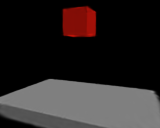
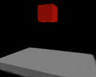

# NPC 用的两张房间照片

这间小屋取自编辑器的“物理实验台”。训练程序读入 32 张有相机位姿的合成图，用 3,214 个三维高斯重建地台和红箱子。下面两个机位只用于验收和游戏查询。每张图都是 160 × 128 像素，红箱子的位置保留在拍摄时刻。[相机与候选物体](index.json) · [原图对照测量](validation.json)

| 从地台一端看 | 从另一端看 |
| --- | --- |
|  |  |

## 在编辑器里试用

在本机启动支持带图输入的视觉模型服务。把下面命令里的模型名和端口换成该服务实际提供的值，在仓库根目录运行。随仓库提供的图片和索引可以直接使用。

```powershell
python scripts/npc_vision.py output/npc-vision/index.json --model redflag-vision --endpoint http://127.0.0.1:8080/v1/chat/completions
```

打开 Vulkan 编辑器，双击项目面板里的 `Physics-Workshop.redflag`，再点菜单栏的“模拟物理”。从“NPC 观察”输入“找一下红箱子”。相机在这个演示中充当伸手的位置，查询距离以米计。返回编号之后，Redflag 用箱子现在的位置重新查碰撞、遮挡和可拿取组件。移动相机、改变可达距离或移除箱子，可以重复查询同一批照片。

在“NPC 观察”输入“请指出地台右侧的灰色台面。”，再点“查询图片”。找到区域后，按“从拍摄机位看向该处”，编辑器会切到“场景 Scene”，移动到拍摄位置，朝向标注框中心。观察照片区域时可以保持编辑模式。这个框没有绑定实体，游戏只会收到拍摄位置与方向，查询结果没有距离或拿取权限。改问“右边那个红箱子是哪一个？”，实际模型会从同一张候选表中选中箱子实体 103。[区域真图与遮挡对照](regions.json)

## 为另一个场景制作图片

从 Brush 0.3.0 的官方发布包解压 `brush_app.exe`。下面用实验台重做一次，需 Python 3.11 或更新版本，示例生成器使用 NumPy、Pillow 和 PyYAML。第一条命令从场景尺寸生成训练图、候选机位的参考图和稀疏点云。第二条命令运行训练，并把训练好的模型、两个机位的新图片和索引一起写到目标目录。[Brush 发布包与校验值](https://github.com/ArthurBrussee/brush/releases/tag/v0.3.0) · [3DGS 论文与作者示例](https://repo-sam.inria.fr/fungraph/3d-gaussian-splatting/)

```powershell
python tests/make_npc_views.py tmp/npc-training
python scripts/bake_npc_views.py C:/Tools/Brush/brush_app.exe tmp/npc-training RedflagForge/assets/scenes/Physics-Workshop.views.json tmp/npc-views --steps 800 --sh-degree 0
```

换用实拍照片时，先准备已标定的相机数据。训练机位放在 `transforms_train.json`，供 NPC 观察的机位放在 `transforms_val.json`。示例的粗语义索引由作者标注，每个机位填写关键词、可见物体的名称与场景里的稳定实体编号。服务按关键词选择图片，模型可以返回一个候选或空值。小模型也可能在两个真实物体之间选错；引擎的射线能够判断拿不拿得到所选物体，物体和提问是否匹配仍取决于识图结果。

需要标出照片上的一块地方时，在该机位的 `regions` 中增加区域名称、关键词和像素框 `bounds`。四个数从左至右依次为左、上、右、下边缘，原点在校正后参考图的左上角。相机标定提供宽高和两个轴的焦距（像素）；主点未指定时取图心。拍摄机位应已对齐游戏的世界坐标。图片服务使用 Pillow 裁出候选框，再让视觉模型确认一次框内的内容。

游戏开发时，保存 `AskNpcVision` 返回的 future，让场景继续更新。等回答就绪，在场景线程调用 `CanPickUp`；它读取当时的实体和碰撞体，供游戏决定后续交互。要复查实际通信，先运行 `tests\run_scene_tests.cmd --physics`，再运行下面的命令。它经过 C++ 游戏接口、本地图片服务和实际配置的视觉模型，再检查距离、遮挡和已删除实体。

同一组两张图分别让两个本地模型识别。Qwen3-VL-2B 在八项测试中答对八项，SmolVLM-500M 答对四项。把标签的顺序调换，能检查模型是否偏向排在前面的名字；把图上半部的箱子遮住，能检查模型还会不会仅凭标签猜箱子存在。这组结果只覆盖实验台上的两个物体。[图片、模型版本与逐项原始回答](recognition.json)

```powershell
python tests/check_npc_vision.py --model redflag-vision --endpoint http://127.0.0.1:8080/v1/chat/completions
```
