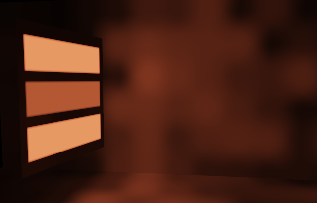

# 灯牌与白墙

`Light-Studio.redflag` 里只有发光面板、白墙、地板和相机。没有点光源，镜面环境光也已关闭。面板的上下两条是白色贴图，中间一条的灰度是 128。材质给三条指定了相同的暖色。贴图使中间一条看起来暗一些，黑色边框则不发光。



保持墙和灯不动，把相机转到画面里完全看不到灯牌的位置。RenderDoc 读回的是调整曝光前的颜色。在白墙世界坐标 (0.75, 1.2, 0) 周围取 5×5 个像素，灯牌打开时的平均 RGB 为 (0.0971, 0.0116, 0.0034)，将同一材质的自发光设为零后是 (0, 0, 0)。此时白墙在画面中央，发光面板完全在画面外。[只看白墙](wall.png) · [同机位关灯](wall-off.png)

第二组画面来自 Epic 的 Sun Temple。比较新旧两版时，房间本身的点光源、曝光和相机都保持原样。火盆上变化最大的一处在 (419, 202)。红通道从 0.274 变为 0.878。自发光纹理覆盖的炭纹很细，整幅图里只有 104 个像素的红通道增加超过 0.1。[读入自发光以前](temple-before.png) · [读入自发光以后](temple.png) · [模型来源和许可](https://developer.nvidia.com/ue4-sun-temple)

以上画面都来自正式 Vulkan 编辑器的第 24 帧，灯牌采用实时 DDGI。随示例另附预先算好的房间光照。重新打开它，从主相机测得墙上同一区域的红色为 0.0954（实时为 0.0964）。关闭 TAA 后，房间在视口大小稳定的 47 帧里只绘制一次，之后 46 帧沿用这张图。[打开烘焙文件后的画面](baked.png) · [两间房的重开记录](../emissive-material/scene-bakes.json)

仓库内置灯牌模型，神庙可用 `python tests/fetch_sun_temple.py` 准备。下面两条命令从仓库根目录运行。可选参数 `--previous` 传入改动前的编辑器程序，能在同一次测试中重拍神庙的对照图。[相机、比较区域与验证条件](../../../tests/check_emissive_scene.py) · [截帧路径、程序校验值与像素读数](frames.json)

```powershell
python tests/fetch_sun_temple.py
python tests/check_emissive_scene.py --renderdoc "C:/Program Files/RenderDoc"
```
