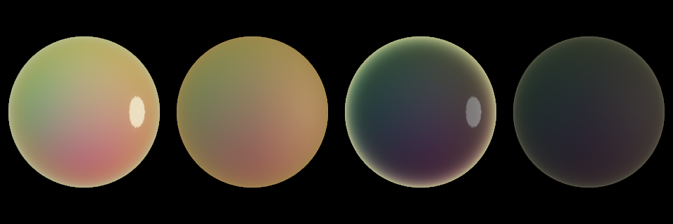

# Vulkan 材质的环境反射

在 Vulkan 编辑器的「环境贴图」菜单选择 HDR 全景或 OpenGL 导出的 `.rfibl`，然后把场景面板切到「组合光照 Lit」。开启「镜面 IBL」，光滑金属就能映出画面外的环境。再开启 SSR，镜中能找到的场景物体会盖住同一处环境反光。「间接光」中还可以改选「环境漫反射 IBL」来照亮涂漆表面。DDGI、ReSTIR GI 与环境漫反射共用一个选择框，各自提供一份漫反射；镜面 IBL 可以和其中任意一项组合。保存场景会保存环境文件位置，保存渲染设置会保存开关。单独的 SSR 教学模式仍可用「示例粗糙度」比较采样分布。

## 光照数据

`RFIBL01` 已经保存好漫反射六面、按粗糙度排列的五层镜面六面和 BRDF 二维表。Vulkan 直接上传这段数据，跳过只用来绘制背景的 2048² 天空。读到原始 HDR 时，GPU 为同样的布局积分。每一处反射方向采 256 个 Hammersley 样本；BRDF 表按视线与法线的夹角、材质粗糙度保存两项系数。原始全景先按面积缩小到最多 1024×512，再取与样本覆盖范围相近的一层，保留明亮小窗对粗糙反射的贡献。一份环境保存在当前场景预览中，改变相机或场景面板尺寸可继续使用。这里使用远处的环境照明；随物体位置变化的室内遮挡仍依赖 SSR、场景光照或局部探针。这个实现不绘制天空背景。可对照 [LearnOpenGL 漫反射环境光](https://learnopengl.com/PBR/IBL/Diffuse-irradiance) 和 [镜面环境光](https://learnopengl.com/PBR/IBL/Specular-IBL)。

测试先在独立 OpenGL 进程中烘焙线性 RGB 为 (2, 1, 0.5) 的常量全景。Vulkan 分别加载原始 HDR 与烘焙文件。比较全部漫反射与镜面六面，逐纹素 RGB 欧氏距离的最大值为 0.00112。比较 512² 个 BRDF 表项，两个系数的平均欧氏距离为 0.00312。两种实现的采样数和存储精度不同，OpenGL 导出半精度浮点，Vulkan 原始 HDR 路径使用 256 个样本和单精度。另用一张自制的彩色天空在 +X 方向放一小片亮窗，分别检查六个面的朝向、+X 与 +Z 公共边，以及反射层混合。

四颗球在同一个程序生成的 HDR 下计算，只显示镜面分量。从左到右分别为光滑金属、粗糙金属、光滑涂漆与粗糙涂漆。各球底色均为 (0.85, 0.48, 0.19)，粗糙度依次取 0.02、0.85、0.02、0.85。出版图独立渲染为 960×320，每颗球直径 216 像素。在每个像素内取四个位置，分别求解析球面的法线并运行引擎的 Vulkan 计算着色器，在线性光下平均后再输出。检查亮窗方向的预过滤图中心，红色通道在最清晰一层读到 6.594，在最粗糙一层读到 1.788。数值保留在线性 HDR 中；PNG 按编辑器相同的显示映射输出。

## 屏幕上的倒影

让两片相同的金属都朝右反射。左边的能在屏幕里找到绿墙，右边的光线会飞出画面。以 RTX 5070 Ti Laptop GPU、Windows Debug x64、160×64 输出运行，打开[实际 RenderDoc 截帧](IBL-SSR_capture.rdc)中的 事件 9（Dispatch，20×8×1 组），检查计算着色器的 Result 缓冲（binding 3）。按左上角为原点，(32,32) 输出 (0, 0.396032, 0.032258, 1)，关闭 IBL 后四个分量逐值相同。(128,32) 输出 (1.716560, 0.511183, 0.119567, 0)，关掉 IBL 就是黑色。第四个分量仅标记 SSR 是否命中，前三个分量是最终的线性 RGB。窗口、材料和接缝的全部数值见[实测表](measurements.csv)，两处像素的原始回放读数、截帧摘要和验证消息见[回放记录](renderdoc.json)。

在仓库根目录构建 Debug x64 引擎后，运行 `tests\run_environment_lighting.cmd`。脚本首次使用时会制作 OpenGL 的对照烘焙，之后的测试进程只创建 Vulkan 设备。可选的第一个参数指定新的输出目录，第二个参数指定本机 RenderDoc DLL 的绝对路径。[测试中的几何和取样位置](../../../tests/EnvironmentLightingTests.cpp)、[全景和烘焙文件加载](../../../Redflag/src/Redflag/Renderer/EnvironmentLighting.cpp)、[环境预过滤与积分](../../../Redflag/src/Redflag/Renderer/ScreenSpace/Shaders/BakeEnvironment.comp)、[镜面反射与 SSR 命中合成](../../../Redflag/src/Redflag/Renderer/ScreenSpace/Shaders/StochasticSSR.comp)。

Sponza 的单独 SSR 模式额外验证了已有教材的两个参数。粗糙度 0.08 时命中 5,269 个像素，改为 0.65 后命中 3,073 个。和接入环境反射前比较，两种设置下命中的像素位置各自完全相同，线性 RGBA 分量的最大差小于 0.00000018。固定随机种子重复绘制，所有分量相同。[逐项记录](teaching-ssr.json)。
