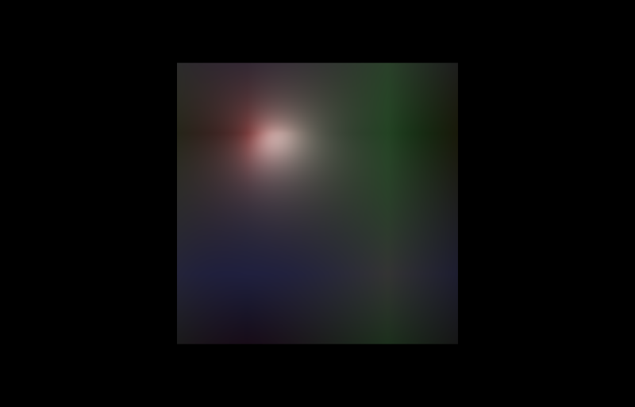
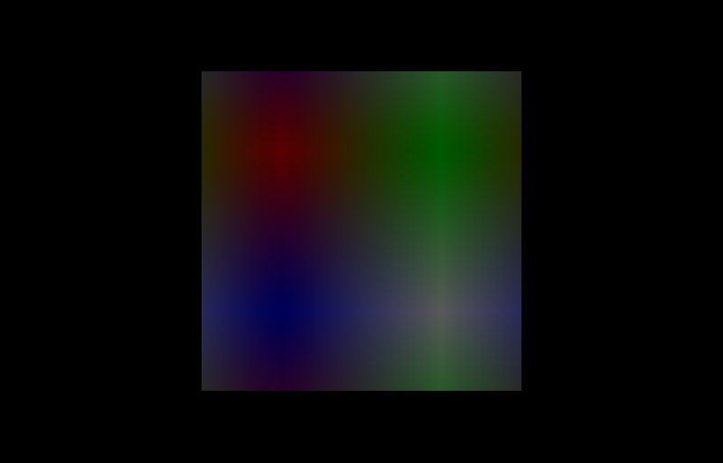
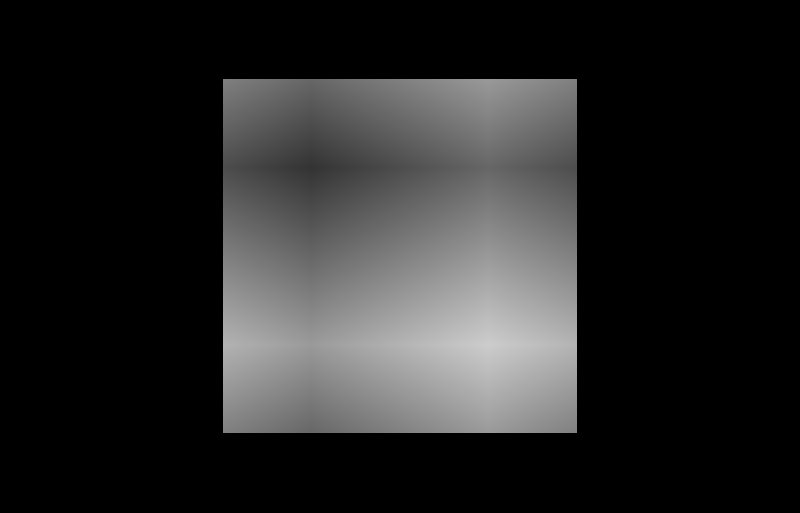
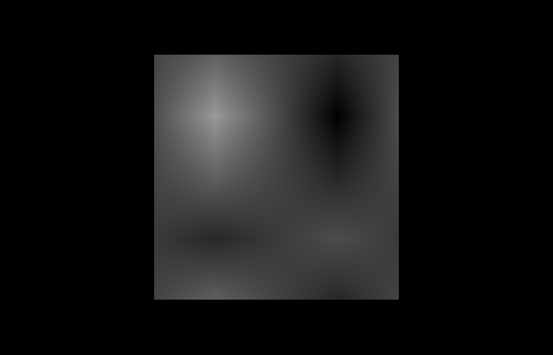
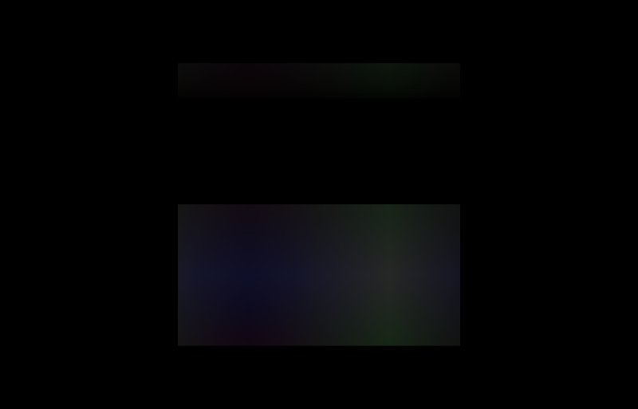
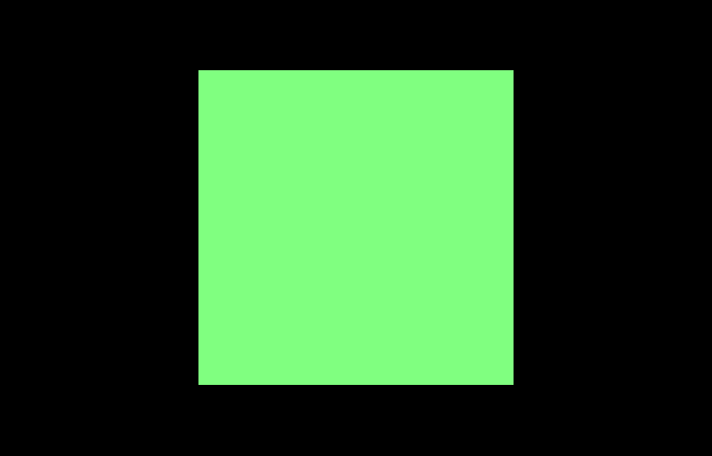
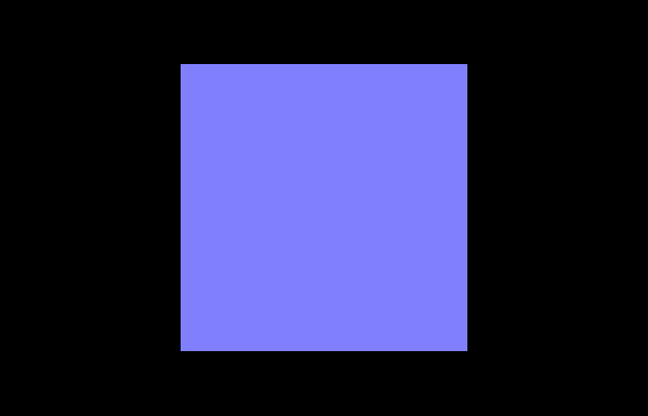

# glTF 材质色板

从 `RedflagForge` 目录启动 Vulkan 编辑器，在“文件”菜单打开 [MaterialChannels.redflag](../../../tests/fixtures/MaterialChannels.redflag)。色板由两个三角形组成，只用一张 2×2 的底色贴图和一张同尺寸的材质贴图。左上角的红色区域使用材质贴图中的 G=64、B=255。乘上模型文件中设定的因子，粗糙度为 $0.8 \times 64 / 255 \approx 0.20078$，金属度为 $0.6 \times 255 / 255 = 0.6$。在相邻像素之间，显卡会用周围四个纹素平滑过渡。[glTF 2.0 材质规范](https://registry.khronos.org/glTF/specs/2.0/glTF-2.0.html#metallic-roughness-material)

| 正式场景面板 | 底色 | 粗糙度 | 金属度 |
| --- | --- | --- | --- |
|  |  |  |  |

图源为 RedflagForge 的同一帧。屏幕上的点光源位于色板前方偏左上。底色贴图要从 sRGB 转为线性亮度，材质贴图的两个通道则直接乘因子。下表给出图中四个纹素中心附近的屏幕坐标，原点在图像左上角。金属度与粗糙度各保留 12 位，再经表面数组交给光照计算。[原始读数](samples.json)

| 底色区域 | 像素 (x, y) | 输入 G / B | GPU 粗糙度 | GPU 金属度 |
| --- | --- | --- | ---: | ---: |
| 红 | (311, 167) | 64 / 255 | 0.200733 | 0.600000 |
| 绿 | (488, 167) | 128 / 0 | 0.401465 | 0.000000 |
| 蓝 | (311, 344) | 192 / 64 | 0.602442 | 0.150672 |
| 白 | (488, 344) | 255 / 128 | 0.800000 | 0.301099 |

## 缺少法线的模型

第一张截帧里，模型正对相机，画面中间却有一条黑带。从绘制事件读取世界空间法线后发现，125,316 个模型像素全部朝上 (0, 1, 0)。这个 glTF 只给了顶点位置和贴图坐标。导入时虽然请求了按面生成法线，项目编译 Assimp 时却关闭了这项功能，模型读到的是缺少法线时的默认值。重新生成工程并启用 Assimp 自带的面法线生成器后，同一帧的 125,316 个像素均指向相机 (0, 0, 1)。下图将法线的 XYZ 从 −1…1 映射到 RGB 的 0…1，图中正绿色较亮表示朝 +Y，蓝色较亮表示朝 +Z。[构建配置](../../../premake5.lua) · [导入回归](../../../tests/ModelImportTests.cpp)

| 修正前的面板 | 修正前的法线 | 修正后的面板 | 修正后的法线 |
| --- | --- | --- | --- |
|  |  |  |  |

## 回放与测试

两份实机帧均在 Windows 的 Debug x64 编辑器中取得，设备为 NVIDIA GeForce RTX 5070 Ti Laptop GPU，RenderDoc 1.47。相机、点光源和材质使用场景文件及其同名设置，场景画幅 800×513，捕获第 12 帧。绘制事件 27 写出底色图及法线深度图，事件 39 将画面还原为带世界坐标的表面数组，事件 87 写入面板显示图。修正后的帧没有 RenderDoc 调试消息。此处检查正确性，未测量速度。

本机原帧分别为 `output/captures/local/MaterialChannels-before-frame12.rdc` 和 `output/captures/local/MaterialChannels-frame12.rdc`。SHA-256 分别为 `4f81ed56ef0c7b923ea206197db245013062ca2a0b8e1ef0ddeba910498da29e` 和 `a31deda58c5d165285eaf3490f7a61ba2a3ed66638c560046bd99ed3061d3bbf`。

在仓库根目录运行以下命令。第一项编译并检查两种后端的几何、材质与拾取，第二项从实际导入的顶点读取法线，最后一项使用 RenderDoc 的 Python 回放修正后的帧，再次导出本页上表的四张图。重拍后可用环境变量 `RF_MATERIAL_CAPTURE` 指定新帧。

```powershell
.\tests\run_rhi_tests.cmd
.\tests\run_model_tests.cmd
qrenderdoc --python tests/replay_material_channels.py
```

RHI 小场景还验证了两个容易撞在一起的值。完全光滑、金属度为零的几何仍须有光照，而背景没有表面。清屏时将底色图的 A 通道设为 0。绘制几何时，将两项 12 位材质值拼成整数，再加 1。两项都为零时写 1，两项都为一时写 16,777,216，32 位浮点数能够精确表示这个范围内的每个整数。光照用的表面数组将有效标志、粗糙度和金属度分别放在位置、法线和底色的第四个分量，三个向量仍占 48 字节。几何管线仍只写原来的两张浮点图，上传一次绘制所需的常量仍为 128 字节。[着色器](../../../Redflag/src/Platform/Vulkan/Shaders/MaterialChannels.glsl) · [像素回归](../../../tests/RHITests.cpp)

当前材质贴图可照常过滤，打包发生在取样和乘因子之后。读回底色图时，计算着色器用 `imageLoad` 取同一像素的原值。如果将来给这张图加 MSAA，需要先解出每个子样本的材质，再决定边缘用哪个表面。直接平均两个打包整数，会得到另一种材质。
