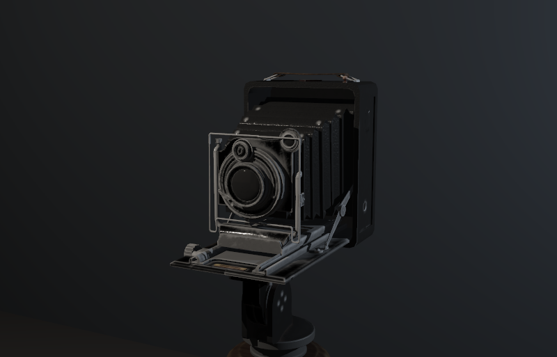
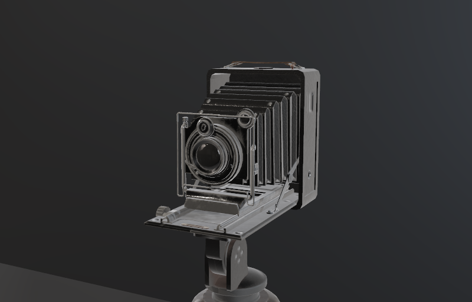

# 摄影棚里的古董相机

从仓库根目录运行 `python tests/fetch_camera_studio.py`，再用 Vulkan 编辑器打开 `assets/scenes/Camera-Studio.redflag`。场景有一台放在三脚架上的古董相机、一面背景墙和两盏点光源。材质沿用模型里的底色、法线和金属粗糙度贴图。选择“主相机 Game”，在“实时效果”里切换“镜面 IBL”，可以专看机身右侧的窄边。想改变倒影中摄影棚的样子，在“环境贴图”菜单换一张 HDR。[场景](../../../RedflagForge/assets/scenes/Camera-Studio.redflag) · [下载脚本](../../../tests/fetch_camera_studio.py)

| 关闭镜面 IBL | 开启镜面 IBL |
| --- | --- |
|  |  |

两幅图来自同一个 Debug x64 Vulkan 编辑器，使用 RTX 5070 Ti Laptop GPU 和 RenderDoc 1.47。保持 DDGI、两盏点光源、相机、TAA 和场景材质相同，固定输出宽 800 像素，各取第 24 帧。两次回放的整幅底色及材质图逐像素相同。以左上方为原点，机身边框 (524,220) 周围 5×5 个像素的红通道均值从 0.00524 变为 0.24281。这里读取显示变换前的线性光照。PNG 则保留编辑器实际显示的亮度。另存的旧版图来自材质和环境反射接入之前，仅用于版本回顾。[原始帧位置、事件和 RGB 读数](measurements.json) · [旧版画面](before.png)

在 PowerShell 中运行下面的命令重拍。将工具参数改成本机包含 `qrenderdoc.exe` 的目录。两个进程各使用一份临时场景，打印原始帧与回放文件的位置；最后一条命令的两个目录取自前两次输出，依次传入关闭和开启时的结果。Windows 侧需要 Python、pywin32、PyYAML、NumPy 和 Pillow。

```powershell
# 仓库根目录，先编译 Debug x64 的 RedflagForge。
python tests/capture_material_studio.py --renderdoc "C:/Program Files/RenderDoc" --no-specular-ibl
python tests/capture_material_studio.py --renderdoc "C:/Program Files/RenderDoc"
python tests/measure_material_studio.py <关闭时的回放目录> <开启时的回放目录>
```

导入时也检查了材质的另一种错误。一份 glTF 仅给第一个材质指定贴图，目录里另放 `other_nor_gl.tga` 和 `other_metal.tga`。旧程序会把这两张图也装到第二个材质上。现在 glTF 按自身记录加载，OBJ 示例仍能按文件名补齐法线或粗糙度图。在 Sponza 上核对了同样的 103 次材质报告，旧版因缺少可选贴图另列出 7,314 行图片名，新版为 0。这是日志行数，两次未计时。[模型导入用例](../../../tests/ModelImportTests.cpp) · [两版 Sponza 的日志统计](import.json)

Antique Camera 来自 Khronos 的 glTF 示例库，作者 Maximillan Kamps / UX3D。模型以 CC0 发布，机身上的 UX3D 标识沿用上游单列的条款。环境图 Studio Small 09 由 Sergej Majboroda 为 Poly Haven 拍摄并以 CC0 发布。两幅画面均由 Redflag 绘制。[模型和署名](https://github.com/KhronosGroup/glTF-Sample-Assets/tree/e124e8d8d7330a5372bc2b4d00d39a4a9d7997ea/Models/AntiqueCamera) · [摄影棚全景](https://polyhaven.com/a/studio_small_09) · [Poly Haven 许可](https://polyhaven.com/license)


### 场景里的发光物体

这次摄影棚实测留下了另一个问题。棚灯来自全景图，而 Sun Temple 火盆里的余烬由模型自己的贴图决定。拍这组相机照片时，引擎还会漏读余烬。后续实现给模型加上了自发光，并用一面白墙验证了灯牌对房间的照明。[灯牌和神庙火盆的对照实测](../emissive-studio/README.md)

### 重开已烘焙的摄影棚

现在摄影棚也随场景保存了环境光和墙面的漫反射。下载模型、环境图后直接打开即可。第 24 帧的 RenderDoc 记录里，事件 78 读取已有探针并为画面计算光照；这一帧没有重新计算探针。在模型上能看到棚灯的倒影，也能看到天光照亮的皮革和背景。复查实机图可运行 `python tests/check_sky_viewport.py camera-studio <RedflagForge.exe 路径>`。[当前画面](../../validation/sky-probes/camera-studio.png) · [回放事件](../../validation/sky-probes/camera-baked-frame.json) · [窗外的环境光](../../../docs/latex/lighting/sky-probes.tex)
