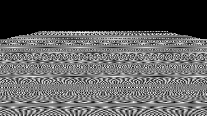

# 远处材质贴图的闪动

两份真实 Vulkan 帧使用同一片地面、一张 256×256 的黑白细格图以及同样的透视相机。地面每个场景单位重复一次贴图；画幅为 256×144。将镜头向右平移 0.007 个场景单位，位于地面 (0,0,−3) 的参照点平移 0.205879 像素。画面直接读出 G-buffer 的线性底色，关闭 TAA、灯光和曝光变化。以左上角为原点，在 x = 32…223、y = 43…85 的 8,256 个地面像素上取平均。

| 线性亮度或误差 | 一层 | 九层 |
|---|---:|---:|
| 两帧对应像素亮度的平均绝对差 | 0.091291 | 0 |
| 第二帧的平均亮度 | 0.242618 | 0.503906 |
| 与等量黑白混合值 0.5 的平均绝对差 | 0.279344 | 0.003906 |

[修前两帧与测量表](old/measurements.csv) 和 [修后测量表](fixed/measurements.csv) 都随目录保留。两张原图分别名为 frame-a.png、frame-b.png；motion-x4.png 是这两张显示图的字节绝对差乘四，用来查看闪动的位置。上表从原始线性浮点颜色取值，亮度 0 为黑，1 为白。

 

## 颜色、数据和拾取

GPU 依据一个像素覆盖的贴图范围选择相邻两层，并在层内和层间线性过滤。底色采用 RGBA8 SRGB，红绿蓝在过滤前还原亮度，写回缩图时再次编码，A 始终表示线性的透明度。法线、金属度、粗糙度和独立透明图按 RGBA8 UNORM 采样。两个用法各有自己的缩图。模型在另一处再次使用同一张源图时，只复制原始第 0 层的字节，之后按新的用途生成各层；调用者能继续共享原来的纹理引用。贴图初次用于材质时上传，后续帧复用 GPU 对象，场景颜色图、拾取图和 UI 面板维持单层。标准双线性缩放在奇数尺寸时按目标纹素中心取样；这里的数值例是每次正好缩半的 256×256 细格。[Khronos 贴图层级教程](https://docs.vulkan.org/tutorial/latest/09_Generating_Mipmaps.html)、[Vulkan 图像复制与过滤规范](https://docs.vulkan.org/spec/latest/chapters/copies.html)。

另让灰度字节 64 与 192 交替排列，把同一张图先作为线性数据图，再同时作为底色和材质图。底色的理想线性均值为 0.289192，设备读出 0.287109；金属度、粗糙度均读到 0.502076，线性数据的理想均值是 128/255 = 0.501961。较近的实色纹素也查了一次，原绿色字节 208 由设备还原为 0.628906，按精确 sRGB 公式是 0.630757，两者编码回 8 位都为 208。在独立透明图的红通道、底色图的 A 通道中，分别用 127 与 128 夹住阈值 0.5；前者在颜色图中留下背景、拾取 ID 为 −1，后者可见并读回实体 7。比一个像素还小的透明细孔仍受贴图过滤及当前材质阈值影响。[一图两用读数](fixed/roles.csv)、[透明与拾取读数](fixed/mask.csv)。

## 截帧与显存

Windows Debug x64，NVIDIA GeForce RTX 5070 Ti Laptop GPU。用 RenderDoc 1.47 打开[旧帧](old/Floor_capture.rdc)或[新帧](fixed/Floor_capture.rdc)，都选事件 11 的地面绘制。在片元着色器里比较 set 0 的底色和 set 3 的材质图。旧版都读同一张单层 UNORM；新版本分别读九层 SRGB 和九层 UNORM。打开第一级缩图，黑白格混合后的底色字节为 188，材质数据字节为 127，两个纹理的 A 都是 255。最终 G-buffer 仍只有一层。[实际回放读数与文件摘要](renderdoc.json)。

256×256 RGBA8 原图有 262,144 字节的纹素。一直减半到 1×1 后，每条链有 349,524 字节的纹素。用 vkGetImageMemoryRequirements 向本机驱动查询，原图需分配 262,144 字节，一条完整链需 351,232 字节，多出的 89,088 字节为 87 KiB（33.98%）。同源图同时作两种用途时，本例的两条链共需 702,464 字节。尺寸、驱动对齐和分配粒度会影响其他图的实际费用。这一组测量对象为画质与显存，未测 GPU 帧时间。[驱动显存分配要求](fixed/allocation.csv)。

构建 Debug x64 后，在仓库根目录运行 [tests/run_texture_minification.cmd](../../../tests/run_texture_minification.cmd)。默认输出到 tmp/texture-minification；若要截帧，另传输出文件夹和本机 renderdoc.dll 的绝对路径。在仓库根目录执行 qrenderdoc --python tests/replay_texture_minification.py 可复查已保存的两份帧。源码见[斜地面、材质与透明用例](../../../tests/TextureMinificationTests.cpp)、[Vulkan 材质资源及层级生成](../../../Redflag/src/Platform/Vulkan/VulkanDrawResources.cpp)、[材质采样](../../../Redflag/src/Platform/Vulkan/Shaders/Mesh.frag)。

正式编辑器也重新打开了 glTF 色板。第 12 帧光栅事件 27 画出材质，事件 39 整理表面字段，事件 87 显示画面。在 125,316 个有模型的像素中，四个色块的粗糙度分别约 0.201、0.401、0.602、0.800，金属度约 0.600、0、0.151、0.301，与模型的绿色/蓝色数据及材质因子相符。RenderDoc 回放的验证消息为 0。[正式编辑器截帧](../../captures/local/Forge-Mips-Chart_frame12.rdc)、[色板像素记录](palette/samples.json)。
