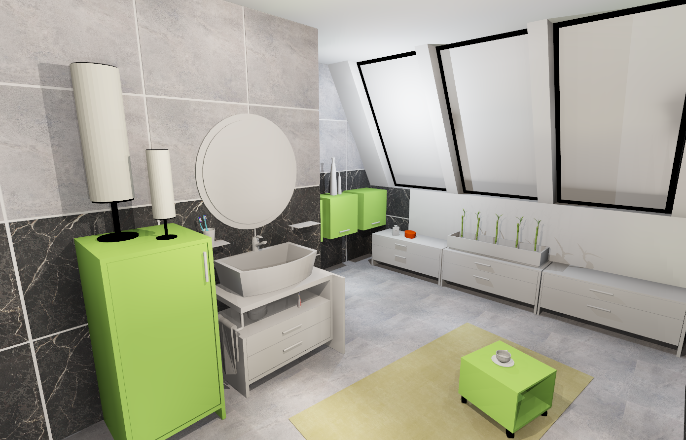
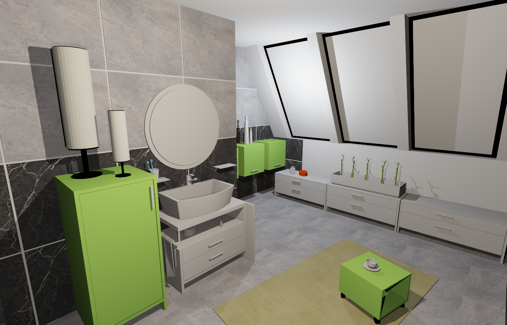
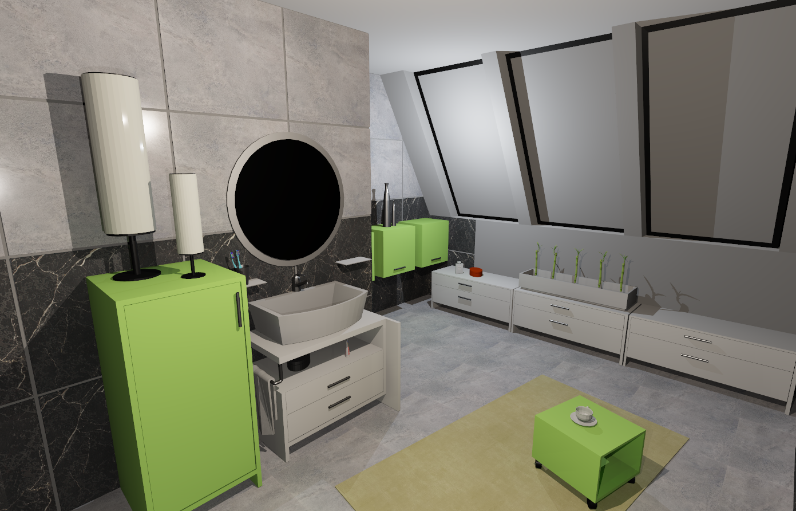

# 浴室

先在仓库根目录执行 `python tests/fetch_rtxgi_bathroom.py`。打开 Vulkan 编辑器，选择「文件 → 打开场景」，载入 [RTXGI-Bathroom.redflag](../../RedflagForge/assets/scenes/RTXGI-Bathroom.redflag)。从门内可以看到洗手盆、浅绿色柜门和大理石墙砖。

在「实时效果 → 间接光」把 DDGI 改成「关闭」，再看洗手盆下方和窗边矮柜的侧面。下面这张图保留相机、三盏点光源和 TAA；关闭间接光后，原来施加在间接光上的 GTAO 也随之退出合成。

这两张图来自正式 Vulkan 编辑器，在 RTX 5070 Ti Laptop GPU 上用 RenderDoc 1.47 回放第 12 帧。图像均为视口的 1391 × 892 像素原始输出。最初照搬示例相机时，镜头落在门墙外，画面几乎全被墙面盖住。最终相机放在门内，正对洗手盆与柜台之间，并为 Redflag 另外配置了三盏点光源。当前光照和机位属于项目的布置。[帧事件与图像校验值](RTXGI-Bathroom.capture.json)

模型由 cenobi 创作，NVIDIA 将它收录在 RTXGI 测试资源中。模型、材质与九张内嵌贴图保持发布版本的 GLB 原样，下载脚本同时保存作者许可。项目保存场景、资源编号与引擎输出图。[NVIDIA 发布目录](https://github.com/NVIDIA-RTX/RTXGI-Assets/tree/6c3caa658d419a00866fcf6b387b0140c1950e17/Bathroom) · [作者署名与许可文件](https://github.com/NVIDIA-RTX/RTXGI-Assets/blob/6c3caa658d419a00866fcf6b387b0140c1950e17/Bathroom/BLENDSWAP_LICENSE.txt) · [Creative Commons Attribution 3.0](https://creativecommons.org/licenses/by/3.0/)

## 房间里预先算好的反光

下面的截图仍在门内拍摄。左侧的灯壳能看见集中的高光，后面的墙砖保留大理石花纹。三盏点光源分别按自己的半径照明，探针把漫反射烘焙四轮。打开「渲染设置 → 质量与参数」可以看到「已烘焙」。移动灯后面板会改为「实时更新」，灯放稳后按「烘焙探针」即可重新保存。前面两张图保留了较早版本的比较条件。[浴室探针文件](../../RedflagForge/assets/scenes/RTXGI-Bathroom.redflag.rfprobes) · [本版截帧及校验值](../profiling/point-materials/bathroom-reopen.json) · [先前的烘焙记录](../profiling/probe-bake/bathroom-reopen.json)

