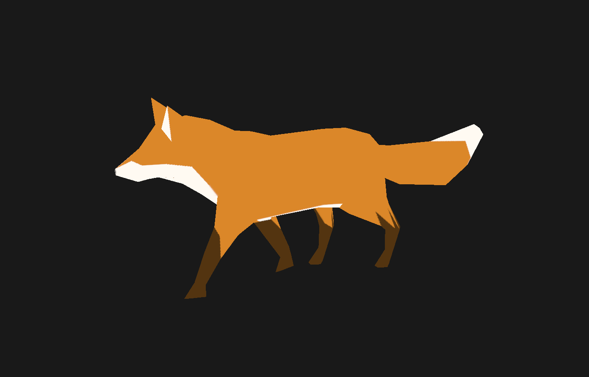
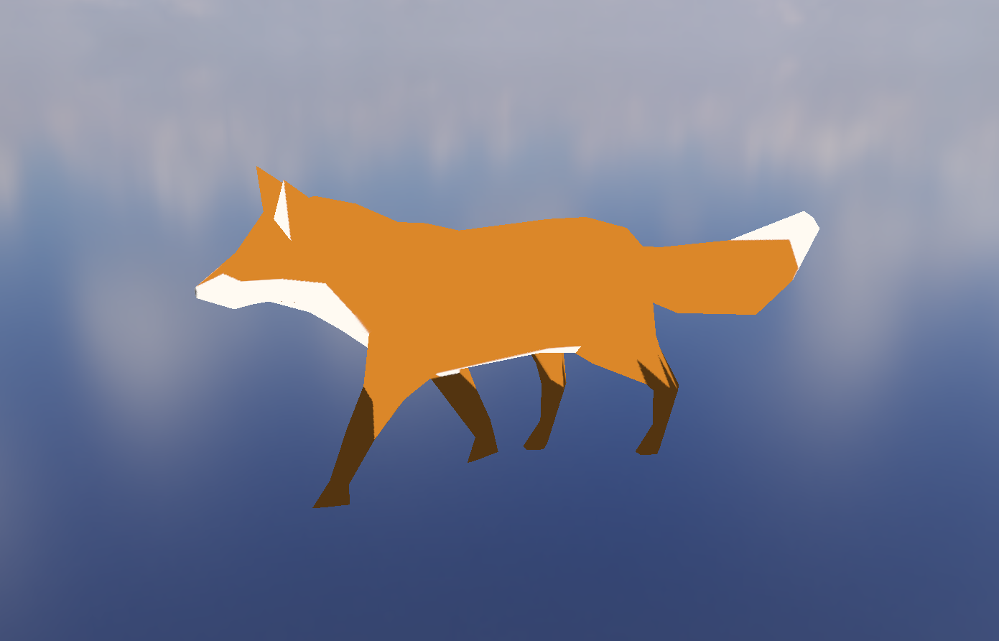
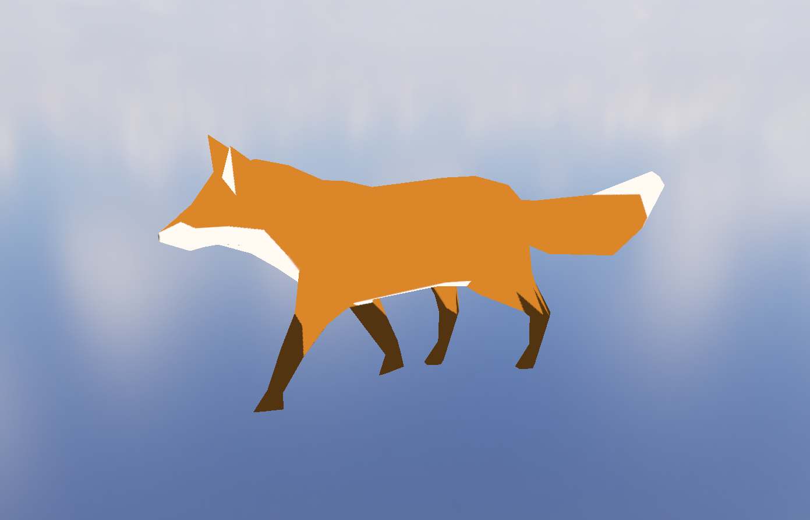

# 狐狸与天空

这个场景只留下相机和一只狐狸。狐狸此时使用模型的底色贴图，动作由骨骼驱动。以前，关掉地面这类静态模型后，编辑器会改用基础绘制，身后的天空也跟着消失了。现在场景面板先显示天空，再叠上同一机位画出的狐狸。角色图中没有画到狐狸的像素是透明的。从尾尖旁边就能看到背景，白色尾尖的颜色应当保持原样。

| 隐藏天空，0 EV | 显示天空，0 EV | 显示天空，+1 EV |
| --- | --- | --- |
|  |  |  |

三张图都从 RenderDoc 回放中裁出最终显示的场景面板。在只有动画角色的这条绘制路径里，曝光与 ACES 色调映射处理天空。角色纹理由基础材质着色器转换为屏幕颜色，随后才叠到场景面板上。右图提高一档曝光，进入 ACES 曲线的天空亮度翻倍，狐狸仍保留底色。场景中有静态模型时，编辑器会走完整的 Lit 绘制路径。[光照图的显示转换](../../../../RedflagForge/src/Shaders/LightingPreview.comp) · [基础材质着色器](../../../../Redflag/src/Platform/Vulkan/Shaders/Mesh.frag) · [场景面板的两次绘制](../../../../RedflagForge/src/VulkanForgeLayer.cpp)

## 同机位检查

在 [Character-Fox.redflag](../../../../RedflagForge/assets/scenes/Character-Fox.redflag) 所在目录复制一份场景，只保留「主相机」和「狐狸」。保持相机变换、模型缩放与原场景一致，把 Walk 动画停在 0 秒（`Time: 0`、`Playing: false`）。环境文件填 `../textures/sky/daylight.hdr`。在同名的 `.redflag.render.yaml` 中设 `Shading: Lit`、`ToneMapping: ACES`、`Indirect: Off`、`TAA: false`。

从 `RedflagForge` 目录运行 `..\bin\Release-windows-x86_64\RedflagForge\RedflagForge.exe --vulkan --scene <副本的绝对路径>` 打开。三次捕捉依次采用 `SkyVisible: false` 与 `ExposureEV: 0`、`SkyVisible: true` 与 `ExposureEV: 0`、`SkyVisible: true` 与 `ExposureEV: 1`。其中 `SkyVisible` 属于场景本身，`ExposureEV` 写在旁边的渲染设置文件里。这次在 RTX 5070 Ti Laptop GPU 上用 Release x64 和 RenderDoc 1.47 捕捉第 24 帧。回放时选最后一次 ImGui 绘制，查看它写入的窗口颜色图；单看天空贴图会漏掉随后叠上的角色。片段来自 Khronos 收录的 Fox 模型，PixelMannen 制作模型，tomkranis 制作骨架及动画，AsoboStudio 和 scurest 完成 glTF 转换。[模型出处与署名](https://github.com/KhronosGroup/glTF-Sample-Assets/tree/main/Models/Fox)

视口为 1391 × 892 像素。用角色图中透明度为 255 的像素确定狐狸轮廓，然后在最终窗口颜色图上逐通道比较。两次对照中，狐狸的 155,563 个像素都保持原值，其余 1,085,209 个背景像素全部发生变化。采样区域、绘制事件、可执行文件和截帧文件的校验值见[原始记录](measurements.json)。
