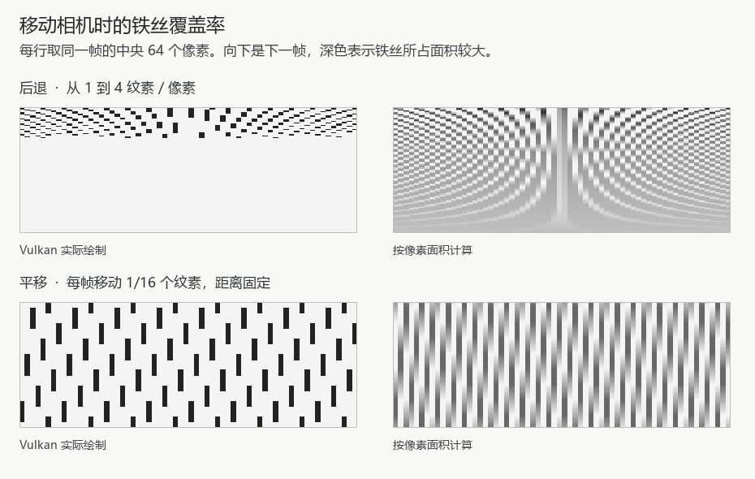

# 移动相机时的铁丝网

铁丝仍用原来的 1024×32 透明图，每四列里有一列实心。把整张图贴在宽两个场景单位的方片上，相机正对铁丝，逐帧改变位置。程序读取正式 Vulkan 着色器画出的每个像素，再从编辑器的拾取图读取中央一整行的实体编号。195 帧共读回 798,720 个覆盖值，12,480 次拾取都与主绘制相符。这里检查的是材质裁剪和拾取，没有叠加 TAA、光照或后处理。



图中每一行是一次实际绘制，向下看就是时间顺序。横向的 64 个位置对应画面中央一行。左边深色代表该帧真的画出了铁丝。右边按每个像素里铁丝所占面积确定深浅，例如覆盖 25% 就画成四分之一深的灰色。这样可以看到，当铁丝变得小于一个像素时，正确变化应当有多大。

## 水平移动

镜头到铁丝的距离固定，每个像素横跨 1.5 个纹素。64 个像素合起来正好容纳 24 组完整花纹，所以镜头向旁边移动时，铁丝在各个像素中所占的面积会变化，但整幅图里实心部分始终占 25%。

相机每帧只移动原图的 1/16 列，一共画 65 帧。第 2 帧（从 0 起算）有 512 个像素显示铁丝，第 3 帧突然增到 1,024 个。实心比例从 12.5% 跳到 25%。在数学参照中，同一对帧的整图比例都为 25%；各像素面积变化的绝对值平均为 2.083 个百分点，最大的也只有 4.167 个百分点。实际绘制却有 512 个像素在两帧间从全空翻成全实心。沿这一条平移路径，覆盖率共跳变 16 次。把相机停在起点再连续绘制 8 帧，读回的轮廓逐像素相同，仍固定在 12.5%。

## 缓慢后退

相机保持朝向，沿 Z 轴后退 121 帧。每帧增加的距离使一个屏幕像素的横向覆盖宽度增加 0.025 个纹素，从 1 个增到 4 个。第 29 帧剩下 384 个铁丝像素，第 30 帧全部消失。此时一个像素跨 1.75 个纹素，面积参照仍为 25%。从这里直到最后一帧，连续 91 帧都画不出铁丝。上图的左上部分记录了这段轨迹，右上部分仍可看见铁丝投影的变化。

上一轮 RenderDoc 回放读到了同一张透明图的缩小层级。第 1 级最大的 alpha 字节为 127，第 2 级起各处都是 64；材质按 0.5 裁剪。这里使用同一纹理、同一材质。远处持续消失与这些输入相符，1.75 是这次机位、花纹和设备的实测过渡位置。[纹理与采样器](../fine-mask/far-after-replay.json)

## 参照和复现

相机正对方片，在这块平面上，每个像素横跨的纹素宽度相同。以原图最左边为零，第一根铁丝占区间 [0,1)，下一根占 [4,5)。从左边到坐标 t 的实心总宽度等于完整周期数，加上最后不足一周期的实心宽度。对同一像素的左右边界分别计算，两者相减，再除以像素横跨的纹素数，就得到了覆盖比例。测试用每帧真实相机位置、投影矩阵的横向缩放量求出这两个边界，又在每个像素内独立取 4,096 个等距样本验证积分，最大绝对差为 0.000238。竖直铁丝的所有像素行都相同，程序也逐行核对过这一点。

在仓库根目录编译 Debug x64 的 Redflag 后运行下面的命令。相机轨迹、纹理和阈值固定，隐藏窗口中的 Vulkan 绘制无需人工操作。数值是运动基准，后续改进时可根据整图覆盖误差、相邻帧的额外跳变和完全消失帧数评估效果。

```bat
tests\run_mask_camera_motion.cmd
```

[相机与实际绘制](../../../tests/MaskCameraMotion.cpp) · [面积计算与图像生成](../../../tests/check_mask_camera_motion.py) · [逐帧相机和结果](frames.csv) · [覆盖、拾取和参照数组](pixels.npz) · [汇总及版本](report.json)
