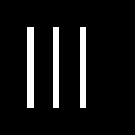
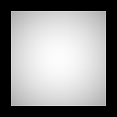
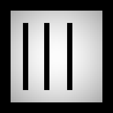
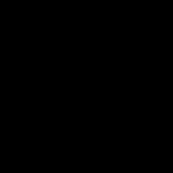
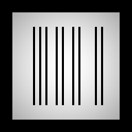

# 细铁丝的近景与远景

铁丝用一张 1024×32 的图片表示，每四列有一列完全实心，其余三列完全透明。测试脚本自行生成图片，放入 [glTF 底图的 A 通道](mask.png) 或 [独立透明图的 R 通道](opacity.png)。房间里只有方片、接收阴影的白墙和点光源。相机和灯在同一位置（0，0，3），所以能选中铁丝的像素，在墙上也应被同一根铁丝遮光。直接光的 PNG 均把线性红通道 0.26 显示为白色。每张图来自 64×64 的 GPU 浮点数组，再按整数倍放大，方便数出线宽。

## 近景

布片占 38×38 个像素，贴图坐标只选取原图中央的 12 列。画面中共有三根铁丝，每根宽三个像素。每个画面像素横向只跨约 0.31 个原图纹素，能清楚区分相邻的线和空隙。

| 观察位置 | 修改前 | 修改后 |
| --- | --- | --- |
| 光栅显示的铁丝 |  |  |
| 相机射线找到的铁丝 |  |  |
| 三根铁丝在墙上的阴影 |  |  |

主相机和拾取始终能识别三根铁丝。原先，GI 导入把底图缩到 512 列，只取原图的奇数列。由于这张图的实心纹素全在偶数列，进入 GI 的 512×16 图片整张透明。新版仍用较小的底图取颜色，但保留原尺寸透明度。RenderDoc 在最近命中和逐灯阴影使用的材料中，读到完整的 32,768 字节透明度，8,192 个纹素为实心。glTF 底图、单独给实体指定的透明度图，以及 OBJ 材质自带的透明度图，都让 342 个铁丝像素正确遮光。像素（26，32）处射线停在布片 z=1，后墙红通道从 0.254676 变成 0。[改前读数](before.json) · [改后读数](after.json) · [改前逐事件回放](before-replay.json) · [改后逐事件回放](after-replay.json)

## 烘焙文件

把点光源换成发光板，在铁丝下方放一枚探针。它朝灯牌的半球发出 64 条光线。旧版有无铁丝都得到 20 次命中，探针红通道为 1.25。新版有铁丝时只有 5 次命中，红通道为 0.3125。这里灯牌的线性红通道是 4，所以平均值就是 4 × 命中数 ÷ 64。另一枚位于孔下的探针两次都得到 33 次命中。在全部 504 枚探针的六个方向中，共 335 份读数随铁丝出现而降低。

为检查缓存，另生成一张全透明图。它只把原图偶数列里的铁丝去掉，缩小后的 512 列与旧图完全相同。固定三件物体的编号和排列后，旧版给两种场景写出同一个烘焙签名，并且能互相读取。新版会区分这两张图，读回同一间房间的新文件，拒绝旧版的铁丝烘焙和全透明图的烘焙。每份文件都核对过 GPU 读回的完整探针数据。[同场景的旧烘焙](before.rfprobes) · [新版烘焙](after.rfprobes)

## 远景留下的问题

相机仍固定在原处，把同一张图的 1024 列都铺到这一片布上。投影宽约 38.63 个像素，每个像素横跨约 26.51 列纹素。原图实心面积占 25%。此时布片投影覆盖的 1,444 个像素均未画出铁丝。另做的 200 次拾取也全部选到白墙。用 RenderDoc 回放，底图实际有 11 级，缩小和相邻级之间均线性过滤。第 4、5 级中的透明度字节全为 64，即约 0.251，低于材质设置的裁剪值 0.5。第 4、5 级是根据每像素覆盖宽度推算出的相邻层，读取到的层内容和采样器设置来自真实帧。

| 固定机位 | 光栅中的铁丝 | 墙面直接光 |
| --- | --- | --- |
| 修改前 |  |  |
| 修改后 |  |  |

新版场景射线按原图上的命中位置取样，这个机位下有 342 个位置被判为遮挡，占 23.68%。因此远景仍能见到阴影，却看不到对应铁丝。这里测量的是单个固定机位，移动镜头时的闪烁还需要连续帧验证。[改前远景](far-before.json) · [改后远景](far-after.json) · [远景纹理和采样器](far-after-replay.json)

## 复现

在仓库根目录先编译 Debug x64 的引擎库，然后编译现有的 Vulkan 材质回归程序。下面第一条命令也会检查原来的小孔用例。两条 Python 命令使用同一程序在独立工作目录里生成近景和远景，输出结果保存在本目录。需要 Python、NumPy 与 Pillow。

```bat
tests\run_gi_mask_tests.cmd
python tests\check_fine_mask.py
python tests\check_fine_mask.py --distant
```

要同时获取帧，在任一 Python 命令后加 `--renderdoc "C:\Program Files\RenderDoc\renderdoc.dll"`。对新版近景设置环境变量 `RF_FINE_MASK_CAPTURE=after`，对远景设置 `RF_FINE_MASK_CAPTURE=far-after`，再从根目录用同版本 qrenderdoc 执行 `--python tests\replay_gi_mask.py`。旧版对照使用保存的旧库与它链接出的程序，通过 `--baseline --exe <旧程序> --lib <旧库>` 重跑，选项 `--distant` 同样适用。旧库和由它编译的测试程序在本机 tmp/fine-mask-freeze 下，分别名为 Redflag.lib、GIMaskTests.exe。换台机器后，也能直接用 RenderDoc 打开 [修改前近景](before_capture.rdc) 和 [修改前远景](far-before_capture.rdc) 检查当时的纹理、着色器和输出。旧库、新库和测试程序的 SHA-256 在对应 JSON 中。[近景原始帧](after_capture.rdc) · [远景原始帧](far-after_capture.rdc) · [生成与验证代码](../../../tests/check_fine_mask.py)
