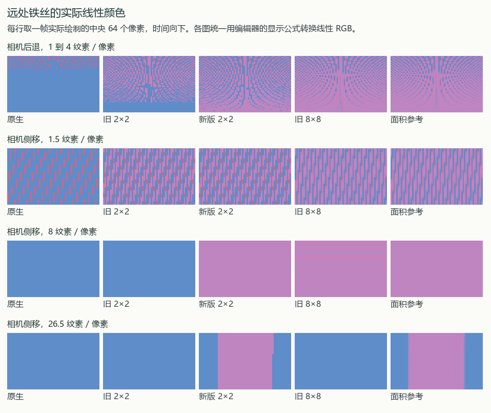
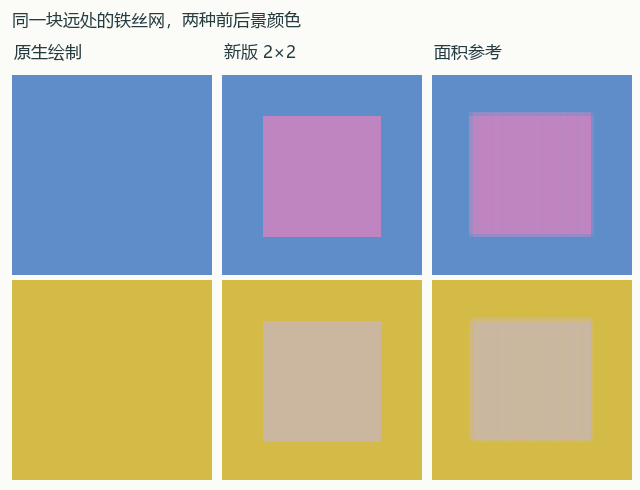

# 远处铁丝的颜色

从相机前放置一块有细孔的自发光面板，再在后面放一块另一种颜色的发光面板。场景没有环境光、点光源或时间累积，每个子像素的线性 RGB 就是该位置实际看见的表面发出的光。两次实验交换了亮色与暗色，也换了色相。每种分辨率都在 Vulkan 中重新画两层几何、写深度、计算自发光，然后把线性颜色平均到 64×64。程序将每个输出像素读回 CPU。

原生模式画 64×64。普通 2×2、4×4、8×8 分别画 128×128、256×256、512×512，使用旧库的透明度裁剪。生产 2×2 绘制 128×128，在绘制表面和自发光时都开启 `SetSubpixelMask`。它还执行编辑器实际使用的 `LightingPreview.comp`。两种颜色的显示输出与“先平均光、再做显示转换”的最大绝对差均为 0.000000060。若先转换再平均，最大差分别为 0.242 和 0.209，单位是 0 到 1 的显示通道值。

铁丝原图的每四列有一列实心。根据相机投影，可以计算一个像素在铁丝方片内占了多少面积，也可以把这个比例乘以前后景的线性 RGB，得到该像素的颜色参考。表中“覆盖误差”是每一像素实际覆盖比例与面积参考之差的绝对值，再对该轨迹全部像素、全部帧取平均。“变化误差”则先算相邻帧同一像素的变化，再减去正确运动本该产生的变化。两项数值的单位都是一像素面积的比例。

| 相机轨迹 | 原生覆盖误差 | 生产 2×2 覆盖误差 | 原生变化误差 | 生产 2×2 变化误差 |
| --- | ---: | ---: | ---: | ---: |
| 后退，121 帧，每像素 1～4 个纹素 | 0.23292 | 0.08558 | 0.09902 | 0.10590 |
| 侧移，65 帧，每像素 1.5 个纹素 | 0.20064 | 0.09135 | 0.05078 | 0.04948 |
| 侧移，65 帧，每像素 8 个纹素 | 0.25000 | <0.00001 | <0.00001 | <0.00001 |
| 侧移，65 帧，每像素 26.5 个纹素 | 0.09114 | 0.00902 | 0.00043 | 0.00047 |

后退时，原生模式、普通 2×2、生产 2×2 末尾连续完全看不到铁丝的帧数分别是 91、21、0。生产 2×2 能保住远处的网，后退过程中的帧间变化误差仍略高于原生模式。每像素横跨 26.5 个纹素时，旧库即使画 512×512 再平均，铁丝也已在选取较小贴图时消失。新算法在中央 32×32 个像素保留的平均铁丝比例是 25%，与该位置的面积参考一致。图案、阈值和视角均固定，本次没有测实际游戏场景的帧率。

在项目根目录运行 `tests\run_mask_supersampling.cmd`。默认将两套测试都链接到现有 Debug 引擎库，第一套关闭新裁剪，第二套开启 2×2。新结果写入并列的 `mask-supersampling-current`。要复现本次历史对照，可先设置 `RF_MASK_BASELINE_LIB` 指向旧库的副本，此次旧库 SHA-256 的前八位为 36d47099。相机轨迹和原生覆盖参考从 fine-mask-motion 目录只读加载。两套可执行文件、库、输入纹理与着色器的 SHA-256 均保存在 [report.json](report.json)。[逐帧数值](frames.csv)与[线性颜色读回](linear-center-rows.npz)可以用来单独复查任意一帧的中央行。
