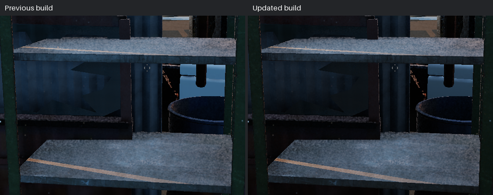

# 维修站工具架的金属反射

走到维修站绿色工具架面前，最容易观察的是银灰色层板和绿色立柱。两张图都是 Vulkan 游戏窗口第 12 帧的完整输出，1920 × 1080。两局都从同一份正式场景复制出测试站位，使用架子原有的漆面和金属粗糙度贴图，保留第三人称相机、天空、直接灯、DDGI、SSR、TAA 和雾。相机朝向和工具架的投影矩阵完全一致，显示都用 ACES、曝光 −0.35 EV。[旧版完整实机图](bc21b15c820b/rack-current.png) · [新版完整实机图](45eef074c3ef/rack-current.png)



上图取两局相同的像素范围，从左上角 (624, 420) 到右下角 (1184, 832)，每半都是 560 × 412，保留原尺寸。看两层架板，新版的整体明暗比旧版略低。我们在 RenderDoc 找到绘制这个架子的 19,116 个索引，比较绘制前后与本帧结束时的深度，只取两局中都属于架子的 242,586 个可见像素。这些位置的底色逐通道一致。曝光前的平均线性亮度从 0.07274 降到 0.06568。两局中的其余光照贡献和之前积累的帧也可能不同，这组数字反映的是两个完整程序运行后的画面。[两个程序、场景、截帧文件的 SHA-256 及亮度记录](comparison.json)

为了量清这次改动的作用，我们随后只打开新版的同一帧，让 RenderDoc 在第 1439 个事件分别执行旧版和修正后的金属反射着色器。这次两边都使用这帧原有的灯光、场景反射、相机和 TAA 历史，送进反射计算的颜色缓冲逐字节相同。243,334 个可见架子像素的平均线性亮度从 **0.0654362 到 0.0655424，上升 0.162%**。经过曝光和显示转换后，按红、绿、蓝的权重计算，平均屏幕亮度只从 55.970 到 56.032（范围 0–255），半数像素的显示亮度没有变化。这个站位的漆面上很难靠肉眼辨出差异。右图的整张游戏画面和正式新版读回完全一致。[同帧着色器与事件](same-frame.json) · [同一位置的原尺寸局部](shader-crop.png)

线性亮度使用 $0.2126R+0.7152G+0.0722B$，直接读取进入曝光和色调映射前的浮点颜色。屏幕亮度用同一组权重计算 PNG 中的 RGB 码值。这里记录整面架子的平均值，以及未放大亮度差的裁图。理想白金属的粗糙度测试和黑环境控制另见[白炉实测](../README.md)。

在 Windows 仓库根目录运行下面的命令，会在独立桌面依次启动两个 Debug 游戏、截取相同帧、提取工具架深度，再用新版同一帧完成着色器替换和比较。两份完整 RDC 各约 1.18 GB，保存在 `output/captures/local/metal-furnace/station`，具体路径和校验值见统计文件。

```powershell
python tests/compare_station_metal.py --before tmp/aa-studies/station-package-native/RedflagForge.exe --after bin/Debug-windows-x86_64/RedflagForge/RedflagForge.exe
```
