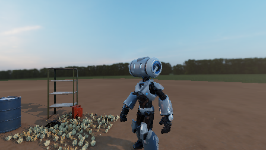

# 瓦特拍到的照片

这页保留早期实现的记录。当时在模型回复期间加上挡板，游戏会丢弃整条照片观察。新版把观察留在记忆里，到做出拿取等操作时才用场景确认。[新版实测，含转告消息与走近复看](../npc-search/README.md)

这张 448 × 252 的原图由正式维修站场景的实体 1102（瓦特）拍摄。设备为 NVIDIA GeForce RTX 5070 Ti Laptop GPU，程序为 Windows x64 Debug。相机调用与游戏「队友通讯 → 从队友眼中观察」相同的 Vulkan 几何与光照绘制。查询只发照片和问题，地图的地貌说明、实体名与光源开关没有写进问题。Qwen3-VL-2B-Instruct 回答中有棕色地表、架子和机器人，也把浅色植被误认为“类似蛋的物体”。拍摄地点、方向、答复与记忆记录见日志。[原图的观察记录](observations.tsv)

## 固定相机的灯光和物体

独立测试场景只有一面白墙、一件红色物体和一盏位于画面外的点光源。相机位置是 (0, 1.55, 0.28) 米，沿 +Z 方向观察。两次都发送同一句英文提问，没有把原图文件名发给模型。只改变游戏中的灯光强度，模型依次选择 `lit`、`dark`。以左上角为原点，在白墙区域取第 100–244 列、第 60–194 行，共 19575 个像素，以 Pillow 的 8 位显示灰度计算，平均值为 247.17 与 0.00。这两个数比较的是 PNG 上墙面的亮暗。[开灯原图](01.png) · [关灯原图](02.png)

| 同一个寻物问题 | 模型看到的内容 | 场景在回答时返回的结果 |
| --- | --- | --- |
| [物体在场](03.png) | 选中特写 B，单看特写仍确认物体存在 | 当前可见，实体 61 |
| [拍照后加入挡板](06.png) | 原照片仍可见 B | 射线先碰到挡板，当前位置看不到实体 61 |
| [拍照后删除物体](04.png) | 原照片仍可见 B | 实体 61 已经离开场景 |
| [删除以后重新拍照](05.png) | 对特写复查后回答 absent | 没有目标，实体编号为 0 |

第一个版本给模型原图以及两个物体的外框坐标。有红色立方体时，模型仍把白墙当作目标。加入按实体像素裁出的特写以后，它能区分立方体和白墙。拿走立方体后，它还会优先选择仅剩的墙面。现在会让模型单独看这张特写，允许回答「没有」。首次出错时的真实答复保留在日志中。这几组结果只代表该模型与这组固定场景。[外框版本的记录](boxes-only/observations.tsv) · [相机和用例代码](../../../tests/NpcCameraTests.cpp)

在仓库根目录构建 Debug x64 的 RedflagForge，启动支持图片的模型服务，运行 `tests\run_scene_tests.cmd --npc-photo ../output/validation/npc-live-camera 8716 --station` 可重新生成原图和日志。服务入口为本机 8716 端口。命令中的输出路径相对 RedflagForge 计算。加上 `--station` 才会另外打开真实关卡，运行瓦特的自由描述。
