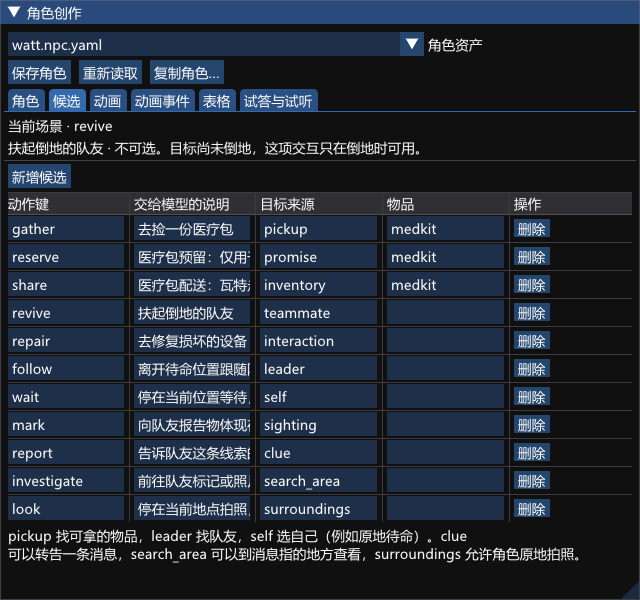

# 在 Forge 查看救援候选

打开「AI 队友」，选中瓦特，勾选「角色创作」，切到「候选」。瓦特的角色文件把 `revive` 指向指定队友。面板会读取队友此时的生命值和交互设置。玩家还站着时，可以在这里看见救援缺席的原因；玩家倒地后，同一处会显示可救的队友和双方的距离。

「队友通讯」中的「最近一次提问的候选」保留发出提问时的选项。如果当时正在行为树的某个子树里，这份列表还会经过该子树的筛选。打开创作面板查看当前场景不会发送新提问。



图由 Forge 的正式 ImGui 面板在独立界面测试中绘制，显示的是测试提供的站立状态。场景检查另用瓦特的正式角色文件和两个引擎实体验证。两人相距 5 米，队友站立时救援从模型候选里消失，倒地后可以选中实体 1101。让队友再次站起，此前提问的候选仍保存着那个实体。删除队友后，当前检查提示「指定的队友已不在当前场景中」。关闭角色的场景观察后，面板只报告该设置。

本轮还从正式输出位置启动了 Debug 版 `RedflagForge.exe`，用 Vulkan 打开 Character-Walk 场景并正常退出。该程序的 SHA-256 为 `4bef9de9a36badafd66bb06ec092287470e702fb00b156f58370c199f5c6db87`。

在仓库根目录运行以下命令。第一条检查场景筛选，第二条重画面板截图。

```powershell
tests\run_scene_tests.cmd --station-companion 0 candidates
tests\run_behavior_tree.cmd --candidate-image output/validation/teammate-candidates/standing.png
```
